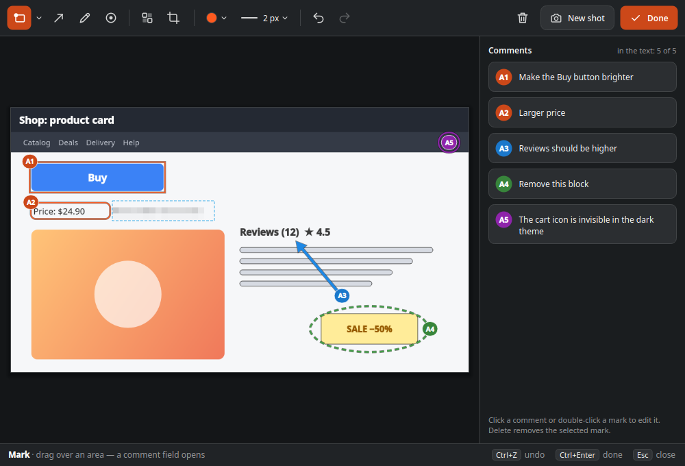
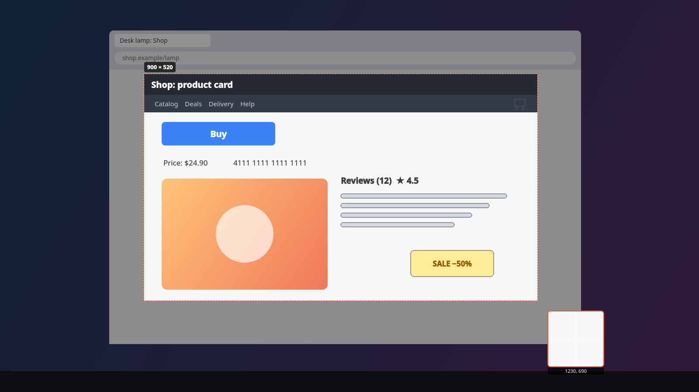
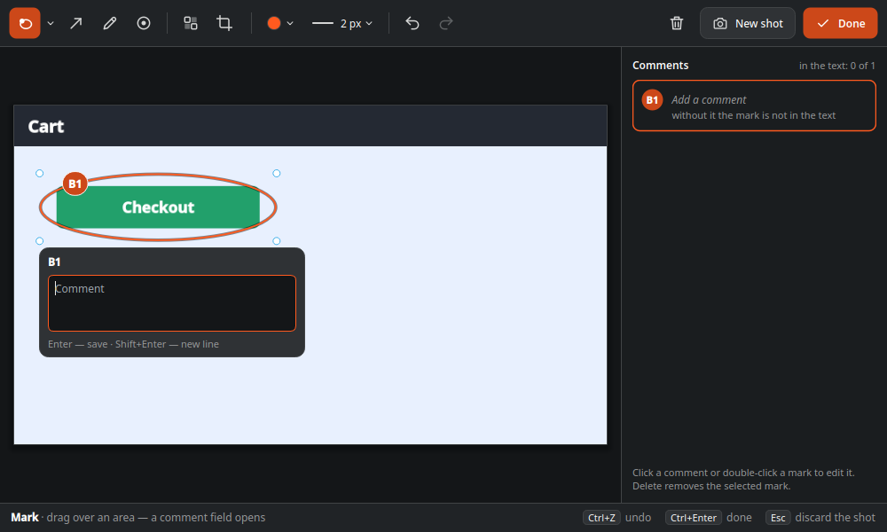
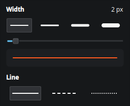
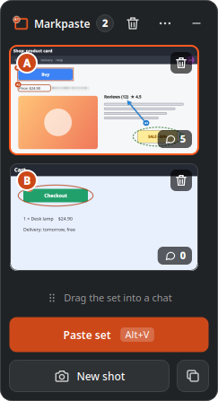
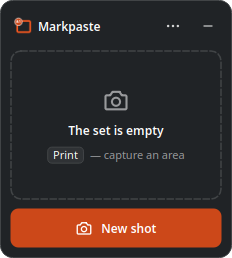
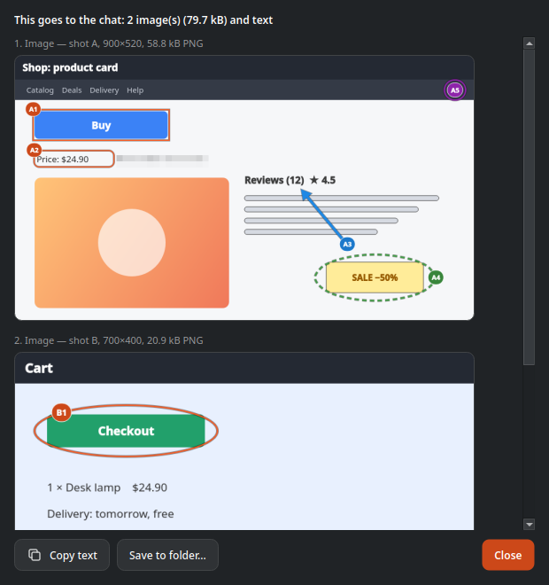
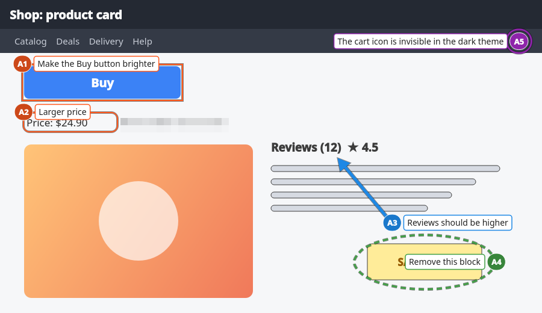
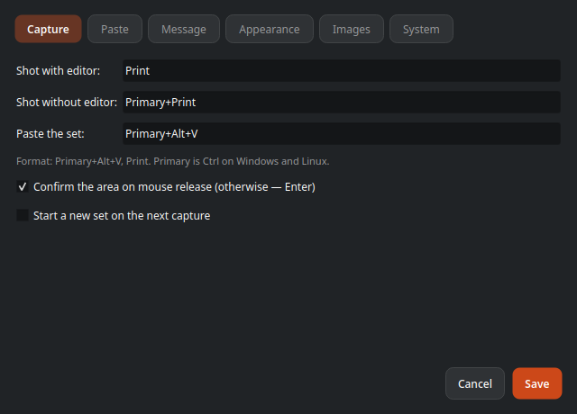

# Markpaste

**English** | [Русский](README.ru.md)

[](https://boosty.to/andrey_che_metallic)

Screenshots with numbered marks and comments, pasted into any chat in one action.

Press a hotkey, select a screen area, put marks A1, A2… on it (frames, arrows, freehand, points) and comment each one. One more hotkey pastes the whole set, images and text, into a chat or an AI assistant:

```
Shot A
A1 Make the Buy button brighter
A2 Larger price
```

Open source, for Linux (KDE Plasma on Wayland first) and Windows 10/11. No network, no accounts, no telemetry.



## Contents

- [What it does](#what-it-does)
- [Platforms](#platforms)
- [Installation](#installation)
- [First start](#first-start)
- [User guide](#user-guide)
- [Keyboard shortcuts](#keyboard-shortcuts)
- [Settings](#settings)
- [Command line](#command-line)
- [Privacy](#privacy)
- [Troubleshooting](#troubleshooting)
- [Building from source](#building-from-source)
- [Documentation](#documentation)
- [Support the project](#support-the-project)
- [License and authors](#license-and-authors)

## What it does

- **Capture an area** with a global hotkey (Print by default). The screen freezes, you drag a frame; a magnifier and the size in pixels help you aim.
- **Mark and comment.** Frames (rectangle, rounded, ellipse), arrows, freehand lines and points are numbered A1, A2… Each mark gets a comment. Every mark can have its own color, width and line style.
- **Blur** passwords and personal data: the chat gets a pixelated copy, the original pixels never leave the program.
- **Crop** a shot, **undo and redo** without limits.
- **Collect up to 26 shots** (A–Z) in a strip at the screen edge. Drag thumbnails to reorder, delete a shot with the trash button.
- **Paste the set** into the active chat with one hotkey: images one by one, then the text. Your clipboard is restored afterwards. The program never presses Enter: you send the message yourself.
- **Fallback modes:** files + text in one clipboard entry, one stitched image + text, dragging the set from the strip into a chat.
- **Preview** what goes to the chat, **save the set to a folder** (PNG + `message.md`).
- Russian and English interface; the message language is set separately.

## Platforms

| Environment | Status |
| --- | --- |
| Fedora 44 KDE Plasma 6, Wayland | ✅ The main platform: checked in daily use |
| Other KDE Plasma 6 distributions on Wayland | ✅ Expected to work the same (needs Qt 6.4+, xdg-desktop-portal) |
| Sway, Hyprland | 🟡 Sequential paste works in tests; bind `markpaste --capture` in the compositor config (Sway has no global shortcuts portal) |
| GNOME 48+ on Wayland | 🟡 Checked on Ubuntu 26.04 (GNOME, Wayland): capture, marks, sequential paste, "Copy set", drag-and-drop. See [On GNOME](#on-gnome) for the differences |
| X11 (KDE, Xfce…) | 🟡 Global hotkeys and paste work in tests (Xvfb); not checked in a real X11 session |
| Windows 11 x64 | ✅ Checked in daily use; the installer is not signed yet |
| Windows 10 x64 | 🟡 Expected to work the same, not checked yet |

Chats checked so far: Claude Code (in a terminal), ChatGPT and Claude in a browser, Telegram Desktop, Mattermost. Details: [docs/platform-matrix.md](docs/platform-matrix.md).

## Installation

Download the packages from the [latest release](https://github.com/metall1c/markpaste/releases/latest).

### Fedora 44

```bash
sudo dnf install ./markpaste-0.2.0-1.fc44.x86_64.rpm
```

### Ubuntu and Debian

Take the package for your release (each one fits only its release):

```bash
sudo apt install ./markpaste_0.2.0-1.ubuntu26.04_amd64.deb   # Ubuntu 26.04
sudo apt install ./markpaste_0.2.0-1.ubuntu24.04_amd64.deb   # Ubuntu 24.04
sudo apt install ./markpaste_0.2.0-1.debian13_amd64.deb      # Debian 13
```

Global shortcuts through the portal need GNOME 48+ or KDE Plasma; on Ubuntu 24.04 (GNOME 46) bind `markpaste --capture` and `markpaste --paste` in the GNOME keyboard settings. Ubuntu 24.04 has no Qt 6 layer-shell library, so on KDE there the strip is an ordinary window and its paste button copies the set (the paste hotkey works as usual).

### Other Linux distributions

`markpaste-0.2.0-Linux.tar.gz` contains the program built on Fedora 44 (it needs the system Qt 6.11). It is easier to [build from source](#building-from-source): it is one CMake command.

### Windows 10/11

- `Markpaste-0.2.0-win64-setup.exe`: an installer, installs into your profile without administrator rights, with a Start menu shortcut and an entry in "Apps".
- `Markpaste-0.2.0-win64-portable.zip`: unpack anywhere and run `markpaste.exe`.

The files are not signed yet, so Windows SmartScreen may warn about an unknown publisher: choose **More info → Run anyway**. The first start of a new version can take up to a minute while Windows Defender checks the files.

## First start

Markpaste lives in the system tray. On the first start a **setup check** window opens: it takes a test shot, asks you to press each hotkey and pastes a test text into its own field. This checks the whole chain on your system and shows what is not available.

On KDE Plasma (Wayland) the desktop asks for permissions once:

1. **Global shortcuts.** KDE shows the shortcuts the program suggests (Print, Ctrl+Print, Ctrl+Alt+V); confirm them or pick others.
2. **Input device control** (the RemoteDesktop portal), needed to press Ctrl+V in the chat for you. KDE asks on the first paste; the permission is remembered.

You can run the check again from the tray menu: **Check setup…**

## User guide

### 1. Capture an area

Press **Print** (Capture with editor). The screen freezes and dims. Drag a frame over the area you need; the size and a magnifier help you aim. Release the mouse to confirm (or Enter if you turned off quick mode). A click without dragging captures the whole monitor; Esc cancels.



Arrow keys move the selection by one physical pixel, Shift+arrows change its size.

**Ctrl+Print** (Capture without editor) puts the shot straight into the strip without opening the editor: handy for collecting several screens quickly and adding marks later.

### 2. Put marks and comments

The editor opens with the **Mark** tool. Drag over a button or a block: a frame appears with the number A1 and a comment field. Type the comment and press **Enter**; Shift+Enter adds a new line.



Tools (the toolbar from left to right):

| Tool | Key | What it does |
| --- | --- | --- |
| Mark | R | A frame; the arrow next to it chooses the shape: rectangle, rounded rectangle, ellipse |
| Arrow | A | An arrow from the tail to the tip; the number sits at the tail |
| Pen | P | A freehand line, e.g. to circle something |
| Point | D | A number badge right on the spot |
| Blur | B | Pixelates the area: passwords, card numbers, names |
| Crop | C | Crops the shot; Enter applies, Esc cancels |

The color and width buttons set the pen for new marks and for the selected one. Each mark can have its own color, width and line style (solid, dashed, dotted).



- Drag a mark to move it, drag its corners to resize it; Delete removes the selected mark.
- Double-click a mark or click its card on the right to edit the comment.
- A mark without a comment stays on the image but does not get into the text. If no shot has comments, only the images are pasted.
- **Ctrl+Z** undoes, **Ctrl+Shift+Z** redoes, without a limit.
- **Ctrl+Enter** or **Done** closes the editor. Esc discards a freshly taken shot (it asks if there are marks) or just closes a shot opened from the strip.
- **New shot** takes the next shot right from the editor.

### 3. Collect a set in the strip

Shots pile up in the strip at the screen edge: A, B, C… up to Z. Each thumbnail shows the letter and the number of comments.



- Click a thumbnail to edit the shot.
- Drag a thumbnail between others to reorder the set: the letters and mark numbers are recomputed.
- The trash button on a thumbnail deletes the shot right away (undo with Ctrl+Z in the editor). The trash in the header clears the whole set.
- Drag the strip by its header to the other screen edge or another monitor.
- **⋯** opens the menu: Preview message, Save to folder, Settings, About.
- **—** hides the strip to the tray. With an empty set the strip hides by itself.



### 4. Paste into a chat

Click into the chat's input field and press **Ctrl+Alt+V** (Paste the set; on Windows just **Ctrl+V**). Markpaste puts the images into the clipboard one by one and presses Ctrl+V for you, then pastes the text. The strip shows the progress; **Stop** interrupts. After the paste your previous clipboard content is restored (not on GNOME, see [On GNOME](#on-gnome)).

You can also press **Paste set** in the strip: on KDE and Windows the strip does not take focus from the chat, so the button pastes the same way.

The message text looks like this (the format is configurable):

```
Shot A
A1 Make the Buy button brighter
A2 Larger price
A3 Reviews should be higher

Shot B
B1 …
```

Other ways to deliver the set:

- **Copy set** (the button next to "New shot"): files + text in one clipboard entry, then press Ctrl+V yourself. Some chats take only the files or only the text from such an entry.
- **Drag the set into a chat** (the handle above the buttons) or drag a single thumbnail: the shots go as files, the text is copied to the clipboard for a second paste.
- **Stitching** (in settings): all shots in one image plus the text, for chats that allow one image per message.

**Preview message…** shows exactly what goes to the chat: the images (with sizes and formats) and the text.



**Save to folder…** writes `A.png`, `B.png`… and `message.md` into a new folder.

### Captions on the image

For chats that separate text from images, turn on **Settings → Message → Also write comments on the image**: each comment is drawn in a plate next to its number. The message text stays as is.



## Keyboard shortcuts

Global (they work in any program; on Wayland the desktop keeps them and you change them in its settings):

| Action | Default |
| --- | --- |
| Capture with editor | Print |
| Capture without editor (straight to the strip) | Ctrl+Print |
| Paste the set | Ctrl+V on Windows, Ctrl+Alt+V on Linux |

On Windows the ordinary **Ctrl+V** pastes the set while the set has shots. With an empty set, and in Markpaste's own windows, Ctrl+V is the ordinary paste. Linux desktops cannot hand a global shortcut back to the active window, so there Ctrl+V would stop working in every program; the settings show an error for it.

The paste shortcut is not Ctrl+Shift+V on purpose: that is "paste as text" in browsers and paste in terminals. On Linux prefer a shortcut with Ctrl. Alt+V works too, but may sometimes paste nothing: to keep the chat from opening its menu on the Alt release, Markpaste presses Ctrl, and the desktop may take that for the keys being released. The settings show a warning for such shortcuts.

Area selection: drag, Enter or mouse release to confirm, click for the whole monitor, arrows to move by a pixel, Shift+arrows to resize, Esc to cancel.

Editor: R, A, P, D, B, C for the tools, Enter to edit the selected mark's comment, Delete to remove it, Ctrl+Z / Ctrl+Shift+Z, Ctrl+Enter to finish, Esc to close or discard.

## Settings

Open them from the tray menu or the strip menu (**⋯ → Settings**).



- **Capture:** the hotkeys (on KDE the **Change shortcuts…** button opens the system dialog), confirm by mouse release or Enter, start a new set on the next capture.
- **Paste:** the mode (sequential, files + text, stitched image), the delay between images, restoring the clipboard, clearing the set after a paste.
- **Message:** the message language, the shot header and mark line format, opening and closing phrases, text before or after the images, captions on the image.
- **Appearance:** the mark color (it also colors the selected tool and the main buttons), a thin dark edge around mark lines, the badge size, the interface language, hiding the strip when the set is empty.
- **Images:** the longest side limit, switching to JPEG above a size, JPEG quality.
- **System:** autostart, keeping the set after a restart, the daily new-version check, the log folder, and what mechanisms are used on your system.

## Command line

A second `markpaste` passes the command to the running one, so you can bind these to keys where the desktop has no global shortcuts:

```
markpaste --capture            capture with editor
markpaste --capture-to-strip   capture without editor
markpaste --paste              paste the set into the active window
markpaste --copy               copy the set (files + text)
markpaste --show | --settings | --setup | --about | --clear | --quit
```

## Privacy

- Shots and comments never leave your computer except when you paste them.
- No telemetry and no accounts. The only network request is the once-a-day check for a new version on GitHub; turn it off in **Settings → System**.
- On KDE the pasted entries are hidden from the Klipper history; on Windows from the Win+V history and cloud clipboard.
- The set is kept in memory. Only with "Keep the set after restart" on is it stored on disk, in `~/.local/share/markpaste/session` (owner-only access). Note that this copy keeps the original pixels under the blur.
- The log (`~/.local/share/markpaste/markpaste/logs/`) has events only, never shot contents or comments.

## Troubleshooting

- **KDE shows "Remote control session started" on every paste.** This is the KDE portal's notification for Ctrl+V emulation; the program cannot turn it off. Hide it in System Settings → Notifications → Applications → KDE portal integration → "Started Remote Desktop".
- **A new shortcut has no key after an update.** KDE asks to confirm new shortcuts; if the dialog was closed without an answer, assign the key with **Settings → Capture → Change shortcuts…**
- **The shortcut I typed in settings does not work.** On Wayland the desktop owns the shortcuts: change them with **Change shortcuts…** (KDE) or in the system keyboard settings.
- **Nothing is pasted, the strip says to click into the chat first.** A Markpaste window (settings, preview) was active; click into the chat's input field and press the paste shortcut again.
- **Capture became slow and a dialog appears after an update.** The program file was replaced while it was running; restart Markpaste.
- **Logs:** `~/.local/share/markpaste/markpaste/logs/markpaste.log` (Windows: `%LOCALAPPDATA%\markpaste\markpaste\logs`). **About → Copy details** copies the version and system info for a bug report.

### On GNOME

GNOME on Wayland gives programs less control than KDE, so some things work differently:

- **The tray icon** (Ubuntu's AppIndicator extension): a single left click opens the menu, a **double click** shows or hides the strip. On KDE a single click does that.
- **Print opens the GNOME screenshot tool.** GNOME takes the key first. The setup check offers **Give Print to Markpaste**; **Settings → Capture → Give the freed keys back to the system** returns it.
- **The strip is an ordinary window.** GNOME places it and may put other windows over it. Drag it by its header anywhere; **right-click the header** and choose **Always on Top** in the GNOME window menu to keep it above other windows (until the strip is hidden or Markpaste restarts).
- **The clipboard is not restored after a paste.** After **Ctrl+Alt+V** the clipboard is empty instead of holding what you copied before: GNOME clears what was put into the clipboard during the paste when the paste ends.

Report problems in [GitHub Issues](https://github.com/metall1c/markpaste/issues) with your OS, desktop, X11 or Wayland, and the chat.

## Building from source

Fedora 44:

```bash
sudo dnf install -y gcc-c++ cmake ninja-build qt6-qtbase-devel qt6-qtbase-private-devel \
  qt6-qtwayland-devel qt6-qttools-devel qt6-linguist qt6-qtsvg-devel layer-shell-qt-devel \
  wayland-devel wayland-protocols-devel libxkbcommon-devel gtest-devel gmock-devel \
  xcb-util-keysyms-devel libXtst-devel
cmake -S . -B build -G Ninja
cmake --build build
cmake --build build --target dev-install-desktop   # the .desktop file: portals and KWin need it
./build/src/app/markpaste
```

Packages (.rpm, .deb), the Windows cross-build and checks: [docs/build.md](docs/build.md). Making a release: [docs/release.md](docs/release.md).

## Documentation

- [docs/status.md](docs/status.md): what is done and what is left.
- [docs/platform-matrix.md](docs/platform-matrix.md): what was checked in which environment.
- [docs/decisions/](docs/decisions/): architecture decisions (ADR).
- [docs/architecture/overview.md](docs/architecture/overview.md): how the program is built.
- [docs/problems.md](docs/problems.md): problems found and how they were solved.
- [TZ.md](TZ.md): the original specification; [docs/deviations.md](docs/deviations.md): where the implementation differs.

## Support the project

Markpaste is free and has no ads. If it saves you time, you can support its development on Boosty:

[](https://boosty.to/andrey_che_metallic)

Boosty may decline some cards issued outside Russia; other ways to donate will be added later. A star on GitHub, a bug report or a word to a friend helps too.

## License and authors

GPL-3.0-or-later, see [LICENSE](LICENSE).

Author: Andrey Che (metallicvrn@gmail.com). The code and documentation were written together with Claude (Anthropic) in Claude Code.
