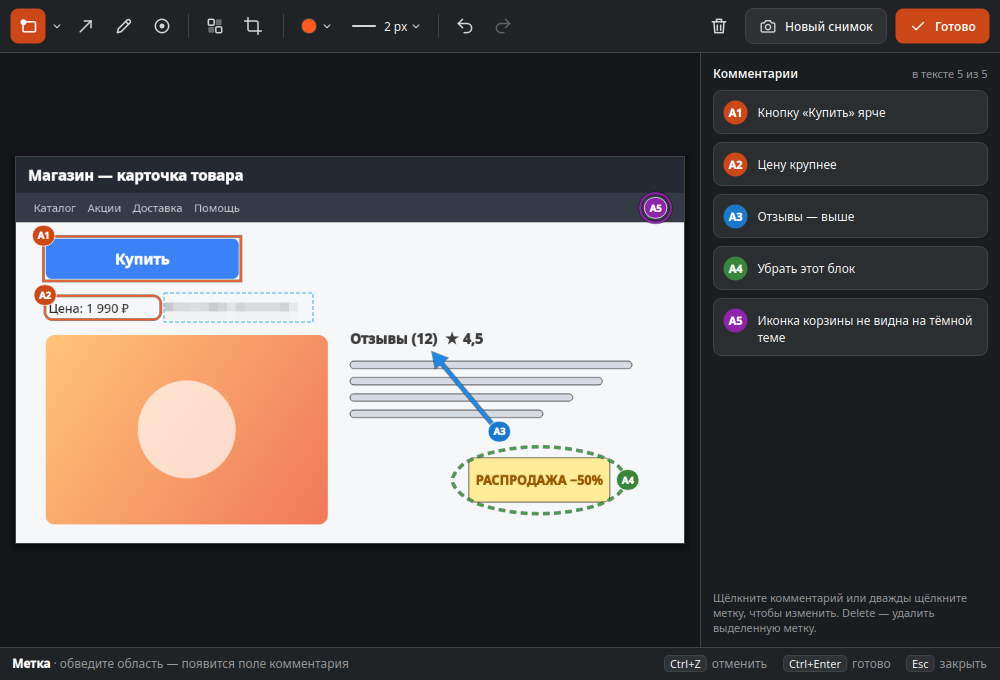
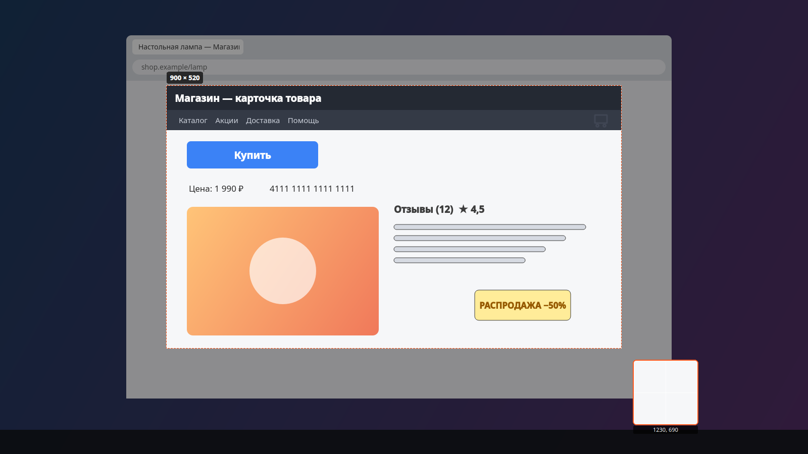
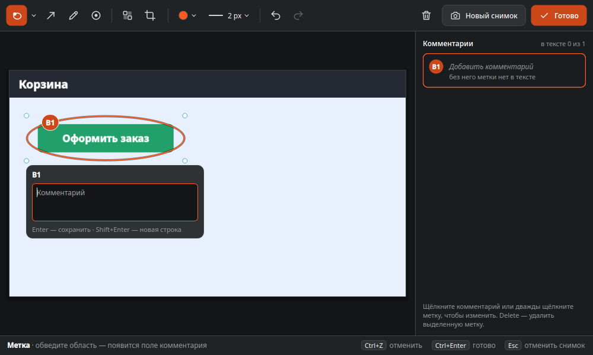
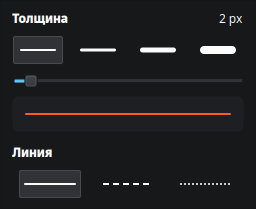
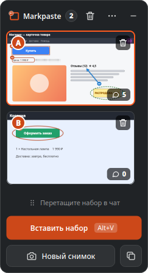
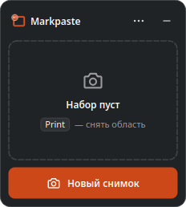
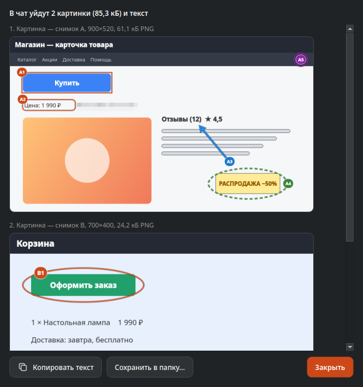
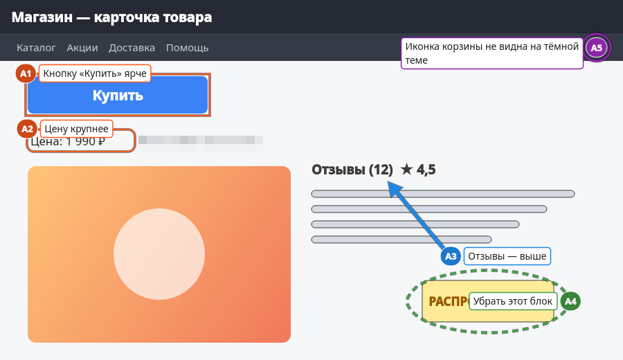
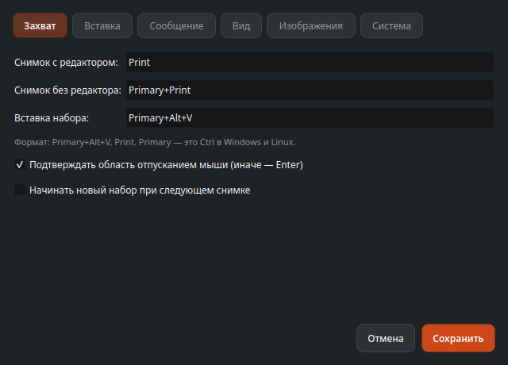

# Markpaste

[English](README.md) | **Русский**

[](https://boosty.to/andrey_che_metallic)

Снимки экрана с нумерованными метками и комментариями — в любой чат одним действием.

Горячая клавиша → выделить область → поставить метки A1, A2… (рамка, стрелка, карандаш, точка) и подписать каждую → ещё одна клавиша вставляет весь набор, картинки и текст, в чат или ИИ-ассистент:

```
Снимок A
A1 Кнопку «Купить» ярче
A2 Цену крупнее
```

Открытая программа для Linux (в первую очередь KDE Plasma на Wayland) и Windows 10/11. Без сети, аккаунтов и сбора статистики.



## Содержание

- [Что умеет](#что-умеет)
- [Платформы](#платформы)
- [Установка](#установка)
- [Первый запуск](#первый-запуск)
- [Как пользоваться](#как-пользоваться)
- [Клавиши](#клавиши)
- [Настройки](#настройки)
- [Командная строка](#командная-строка)
- [Приватность](#приватность)
- [Если что-то не так](#если-что-то-не-так)
- [Сборка из исходников](#сборка-из-исходников)
- [Документация](#документация)
- [Поддержать проект](#поддержать-проект)
- [Лицензия и авторы](#лицензия-и-авторы)

## Что умеет

- **Снимок области** по глобальной клавише (по умолчанию Print). Экран замирает, вы обводите рамку; лупа и размер в пикселях помогают попасть точно.
- **Метки и комментарии.** Рамки (прямоугольник, скруглённый, овал), стрелки, линии карандашом и точки нумеруются A1, A2… К каждой — комментарий. У каждой метки могут быть свои цвет, толщина и тип линии.
- **Размытие** паролей и личных данных: в чат уйдёт пикселизованная копия, исходные пиксели из программы не выходят.
- **Обрезка** снимка, **отмена и повтор** без ограничения глубины.
- **До 26 снимков** (A–Z) копятся в ленте у края экрана. Миниатюры можно перетаскивать, чтобы поменять порядок, и удалять кнопкой-корзиной.
- **Вставка набора** в активный чат одной клавишей: картинки по очереди, потом текст. Прежнее содержимое буфера обмена возвращается. Enter программа не нажимает никогда: сообщение отправляете вы.
- **Запасные режимы:** файлы и текст одной записью в буфере, одна склеенная картинка с текстом, перетаскивание набора из ленты в чат.
- **Предпросмотр** того, что уйдёт в чат, **сохранение набора в папку** (PNG и `message.md`).
- Интерфейс на русском и английском; язык текста сообщения выбирается отдельно.

## Платформы

| Окружение | Состояние |
| --- | --- |
| Fedora 44 KDE Plasma 6, Wayland | ✅ Главная платформа: проверено в ежедневной работе |
| Другие дистрибутивы с KDE Plasma 6 на Wayland | ✅ Должно работать так же (нужны Qt 6.4+ и xdg-desktop-portal) |
| Sway, Hyprland | 🟡 Последовательная вставка проходит тесты; `markpaste --capture` привязывается в конфиге композитора (в Sway нет портала глобальных клавиш) |
| GNOME 48+ на Wayland | 🟡 Проверено на Ubuntu 26.04 (GNOME, Wayland): снимок, метки, последовательная вставка, «Копировать набор», перетаскивание. Отличия — в разделе [В GNOME](#в-gnome) |
| X11 (KDE, Xfce…) | 🟡 Глобальные клавиши и вставка проходят тесты (Xvfb); в настоящей сессии X11 не проверялось |
| Windows 11 x64 | ✅ Проверено в ежедневной работе; установщик пока не подписан |
| Windows 10 x64 | 🟡 Должно работать так же, пока не проверялось |

Проверенные чаты: Claude Code (в терминале), ChatGPT и Claude в браузере, Telegram Desktop, Mattermost. Подробности — [docs/platform-matrix.md](docs/platform-matrix.md) (на английском).

## Установка

Пакеты — в [последнем релизе](https://github.com/metall1c/markpaste/releases/latest).

### Fedora 44

```bash
sudo dnf install ./markpaste-0.2.1-1.fc44.x86_64.rpm
```

### Ubuntu и Debian

Возьмите пакет для своей версии (каждый подходит только к ней):

```bash
sudo apt install ./markpaste_0.2.1-1.ubuntu26.04_amd64.deb   # Ubuntu 26.04
sudo apt install ./markpaste_0.2.1-1.ubuntu24.04_amd64.deb   # Ubuntu 24.04
sudo apt install ./markpaste_0.2.1-1.debian13_amd64.deb      # Debian 13
```

Глобальные клавиши через портал работают в GNOME 48+ и KDE Plasma; в Ubuntu 24.04 (GNOME 46) привяжите `markpaste --capture` и `markpaste --paste` в настройках клавиатуры GNOME. В Ubuntu 24.04 нет библиотеки layer-shell для Qt 6, поэтому на KDE там лента — обычное окно, и её кнопка вставки копирует набор (сочетание вставки работает как обычно).

### Другие дистрибутивы Linux

С версии 0.2.2 есть `markpaste-X.Y.Z-linux-x86_64.tar.gz`: одна программа для любого дистрибутива с glibc 2.35 и новее (Debian 12, Ubuntu 22.04, Fedora 36, Arch, openSUSE Tumbleweed и более новые). Qt у неё свой, поэтому обновления дистрибутива и Qt её не ломают. Распакуйте архив и запустите установщик:

```bash
tar xzf markpaste-X.Y.Z-linux-x86_64.tar.gz
markpaste-X.Y.Z-linux-x86_64/install.sh            # в ~/.local; sudo … --system — в /usr/local
```

Повторный запуск обновляет программу, `--uninstall` удаляет. Она выглядит по-своему, а не в системном стиле (Breeze), и ввод через fcitx в ней не работает (ibus работает). До 0.2.1 архив был сборкой для Fedora 44 и требовал системный Qt 6.11.

### Windows 10/11

- `Markpaste-0.2.1-win64-setup.exe` — установщик: ставит в профиль пользователя без прав администратора, добавляет ярлык в «Пуск» и запись в «Приложения».
- `Markpaste-0.2.1-win64-portable.zip` — распакуйте куда угодно и запустите `markpaste.exe`.

Файлы пока не подписаны, поэтому SmartScreen может предупредить о неизвестном издателе: нажмите **Подробнее → Выполнить в любом случае**. Первый запуск новой версии может занять до минуты: Защитник Windows проверяет файлы.

## Первый запуск

Markpaste работает в фоне, значок — в трее. При первом запуске открывается окно **проверки системы**: программа делает пробный снимок, просит нажать каждую клавишу и вставляет пробный текст в своё поле. Так проверяется вся цепочка на вашей системе, и видно, чего на ней нет.

На KDE Plasma (Wayland) система один раз спрашивает разрешения:

1. **Глобальные клавиши.** KDE показывает предложенные программой сочетания (Print, Ctrl+Print, Ctrl+Alt+V): подтвердите их или выберите другие.
2. **Управление устройством ввода** (портал RemoteDesktop) — чтобы нажать Ctrl+V в чате за вас. KDE спросит при первой вставке; разрешение запоминается.

Проверку можно повторить из меню трея: **Проверка настройки…**

## Как пользоваться

### 1. Снимите область

Нажмите **Print** («Снимок с редактором»). Экран замирает и темнеет. Обведите мышью нужную область — рядом видны размер и лупа. Отпустите мышь, чтобы подтвердить (или Enter, если быстрый режим выключен). Щелчок без протягивания снимает весь монитор, Esc — отмена.



Стрелки сдвигают выделение на физический пиксель, Shift+стрелки меняют размер.

**Ctrl+Print** («Снимок без редактора») кладёт снимок сразу в ленту, не открывая редактор: удобно быстро собрать несколько экранов, а метки поставить потом.

### 2. Поставьте метки и напишите комментарии

Редактор открывается с инструментом **Метка**. Обведите кнопку или блок — появится рамка с номером A1 и поле комментария. Напишите комментарий и нажмите **Enter**; Shift+Enter — новая строка.



Инструменты (панель слева направо):

| Инструмент | Клавиша | Что делает |
| --- | --- | --- |
| Метка | R | Рамка; стрелка рядом выбирает форму: прямоугольник, скруглённый прямоугольник, овал |
| Стрелка | A | Стрелка от хвоста к острию; номер стоит у хвоста |
| Карандаш | P | Линия от руки — например, обвести что-то |
| Точка | D | Значок номера прямо на месте |
| Размыть | B | Пикселизует область: пароли, номера карт, имена |
| Обрезка | C | Обрезает снимок; Enter — применить, Esc — отменить |

Кнопки цвета и толщины задают перо для новых меток и для выделенной. У каждой метки могут быть свои цвет, толщина и тип линии (сплошная, штрихи, точки).



- Метку можно перетащить, за углы — изменить размер; Delete удаляет выделенную.
- Двойной щелчок по метке или щелчок по её карточке справа — правка комментария.
- Метка без комментария остаётся на картинке, но в текст не попадает. Если комментариев нет ни у одного снимка, вставляются только картинки.
- **Ctrl+Z** — отменить, **Ctrl+Shift+Z** — повторить, без ограничения глубины.
- **Ctrl+Enter** или **Готово** закрывает редактор. Esc отменяет только что сделанный снимок (если на нём есть метки — спросит) или просто закрывает снимок, открытый из ленты.
- **Новый снимок** — следующий снимок прямо из редактора.

### 3. Соберите набор в ленте

Снимки копятся в ленте у края экрана: A, B, C… до Z. На миниатюре — буква и число комментариев.



- Щелчок по миниатюре открывает снимок на правку.
- Перетащите миниатюру между другими, чтобы поменять порядок: буквы и номера меток пересчитаются.
- Корзина на миниатюре сразу удаляет снимок (отменить — Ctrl+Z в редакторе). Корзина в заголовке очищает весь набор.
- Ленту можно перетащить за заголовок к другому краю экрана или на другой монитор.
- **⋯** — меню: «Предпросмотр сообщения…», «Сохранить в папку…», «Настройки», «О программе».
- **—** сворачивает ленту в трей. Когда набор пуст, лента прячется сама.



### 4. Вставьте в чат

Щёлкните в поле ввода чата и нажмите **Ctrl+Alt+V** («Вставить набор»; в Windows — просто **Ctrl+V**). Markpaste по очереди кладёт картинки в буфер обмена и сам нажимает Ctrl+V, потом вставляет текст. Лента показывает ход вставки, **Стоп** её прерывает. После вставки в буфер возвращается прежнее содержимое (кроме GNOME, см. [В GNOME](#в-gnome)).

Можно нажать и **Вставить набор** в ленте: на KDE и Windows лента не забирает фокус у чата, поэтому кнопка вставляет так же.

Текст сообщения выглядит так (формат настраивается):

```
Снимок A
A1 Кнопку «Купить» ярче
A2 Цену крупнее
A3 Отзывы — выше

Снимок B
B1 …
```

Другие способы передать набор:

- **Скопировать набор** (кнопка рядом с «Новый снимок»): файлы и текст одной записью в буфере, дальше Ctrl+V нажимаете вы. Некоторые чаты берут из такой записи только файлы или только текст.
- **Перетащите набор в чат** (ручка над кнопками) или перетащите одну миниатюру: снимки уйдут файлами, а текст скопируется в буфер для второй вставки.
- **Склейка** (в настройках): все снимки одной картинкой плюс текст — для чатов, где в сообщении одна картинка.

**Предпросмотр сообщения…** показывает ровно то, что уйдёт в чат: картинки (с размером и форматом) и текст.



**Сохранить в папку…** записывает `A.png`, `B.png`… и `message.md` в новую папку.

### Подписи на картинке

Для чатов, где текст отрывается от картинок, включите **Настройки → Сообщение → Писать комментарии и на картинке, рядом с номерами**: каждый комментарий рисуется плашкой у своего номера. Текст сообщения при этом не меняется.



## Клавиши

Глобальные (работают в любой программе; на Wayland их хранит система, и меняются они в её настройках):

| Действие | По умолчанию |
| --- | --- |
| Снимок с редактором | Print |
| Снимок без редактора (сразу в ленту) | Ctrl+Print |
| Вставить набор | Ctrl+V в Windows, Ctrl+Alt+V в Linux |

В Windows обычное **Ctrl+V** вставляет набор, пока в нём есть снимки. С пустым набором и в окнах самого Markpaste Ctrl+V — обычная вставка. В Linux система не умеет вернуть глобальное сочетание активному окну, и Ctrl+V перестало бы работать во всех программах, поэтому настройки показывают для него ошибку.

Сочетание вставки специально не Ctrl+Shift+V: это «вставить как текст» в браузерах и вставка в терминалах. В Linux лучше выбирать сочетание с Ctrl. Alt+V тоже работает, но иногда может ничего не вставить: чтобы чат не открыл меню по отпусканию Alt, Markpaste нажимает Ctrl, и система может принять это за отпускание клавиш. Для таких сочетаний настройки показывают предупреждение.

Выделение области: протянуть мышью, Enter или отпускание — подтвердить, щелчок — весь монитор, стрелки — сдвиг на пиксель, Shift+стрелки — размер, Esc — отмена.

Редактор: R, A, P, D, B, C — инструменты, Enter — комментарий выделенной метки, Delete — удалить её, Ctrl+Z / Ctrl+Shift+Z, Ctrl+Enter — готово, Esc — закрыть или отменить снимок.

## Настройки

Открываются из меню трея или меню ленты (**⋯ → Настройки**).



- **Захват:** клавиши (на KDE кнопка **Изменить сочетания…** открывает диалог системы), подтверждение отпусканием мыши или Enter, новый набор при следующем снимке.
- **Вставка:** режим (по очереди, файлы + текст, склеенная картинка), пауза между картинками, возврат буфера, очистка набора после вставки.
- **Сообщение:** язык текста, формат заголовка снимка и строки метки, вводная и заключительная фразы, текст до или после картинок, подписи на картинке.
- **Вид:** цвет меток (им же выделены выбранный инструмент и главные кнопки), тонкая тёмная кайма вокруг линий, размер значка номера, язык интерфейса, прятать ленту, когда набор пуст.
- **Изображения:** ограничение длинной стороны, переход на JPEG выше заданного размера, качество JPEG.
- **Система:** автозапуск, хранение набора между перезапусками, проверка новой версии раз в день, папка журнала и какие механизмы используются на вашей системе.

## Командная строка

Второй `markpaste` передаёт команду работающему — эти команды можно привязать к клавишам там, где у системы нет глобальных сочетаний:

```
markpaste --capture            снимок с редактором
markpaste --capture-to-strip   снимок без редактора
markpaste --paste              вставить набор в активное окно
markpaste --copy               скопировать набор (файлы + текст)
markpaste --show | --settings | --setup | --about | --clear | --quit
```

## Приватность

- Снимки и комментарии не покидают компьютер, кроме вставки вами.
- Нет телеметрии и аккаунтов. Единственный сетевой запрос — раз в день проверка новой версии на GitHub; отключается в **Настройки → Система**.
- На KDE вставляемые записи не попадают в историю Klipper, на Windows — в журнал Win+V и облачный буфер.
- Набор хранится в памяти. Только при включённом «Сохранять набор между перезапусками» он лежит на диске — в `~/.local/share/markpaste/session` (доступ только у владельца). Учтите: в этой копии под размытием остаются исходные пиксели.
- В журнале (`~/.local/share/markpaste/markpaste/logs/`) — только события, без содержимого снимков и комментариев.

## Если что-то не так

- **KDE на каждую вставку пишет «Удалённо управляемый сеанс начат».** Это уведомление портала KDE об эмуляции Ctrl+V, программа его не отключит. Скрыть: «Параметры системы» → «Уведомления» → «Параметры приложений» → «Интеграция KDE с порталами» → «Started Remote Desktop».
- **После обновления у новой клавиши нет сочетания.** KDE просит подтвердить новые сочетания; если диалог закрыли без ответа, назначьте клавишу кнопкой **Настройки → Захват → Изменить сочетания…**
- **Сочетание, введённое в настройках, не работает.** На Wayland клавишами владеет система: меняйте их кнопкой **Изменить сочетания…** (KDE) или в настройках клавиатуры системы.
- **Ничего не вставилось, лента просит сначала щёлкнуть в окне чата.** Было активно окно Markpaste (настройки, предпросмотр): щёлкните в поле ввода чата и нажмите сочетание ещё раз.
- **После обновления снимок стал медленным и появляется диалог.** Файл программы заменили, пока она работала: перезапустите Markpaste.
- **Журнал:** `~/.local/share/markpaste/markpaste/logs/markpaste.log` (Windows: `%LOCALAPPDATA%\markpaste\markpaste\logs`). **О программе → Скопировать сведения** копирует версию и сведения о системе для сообщения об ошибке.

### В GNOME

GNOME на Wayland даёт программам меньше возможностей, чем KDE, поэтому кое-что работает иначе:

- **Значок в трее** (расширение AppIndicator в Ubuntu): одиночный левый щелчок открывает меню (первый пункт — **Показать ленту**), быстрый **двойной** показывает или прячет ленту. В KDE это делает одиночный щелчок.
- **Print открывает скриншотер GNOME.** GNOME перехватывает клавишу раньше. Проверка настройки предлагает **Отдать Print программе Markpaste**; **Настройки → Захват → Вернуть освобождённые клавиши системе** возвращает её.
- **Лента — обычное окно.** Её ставит GNOME, и другие окна могут её закрыть. Перетаскивайте её за заголовок куда угодно; **правый щелчок по заголовку** открывает меню окна GNOME, там **Поверх всех окон** держит ленту над остальными окнами (пока Markpaste не перезапущен).
- **Скрытие ленты сворачивает её.** **—** и пустой набор не прячут ленту, а сворачивают, поэтому она возвращается туда, где была; свёрнутая лента видна в доке.
- **Буфер обмена после вставки не восстанавливается.** После **Ctrl+Alt+V** буфер пуст, а не содержит то, что вы копировали раньше: GNOME стирает записанное в буфер во время вставки, когда вставка заканчивается.

Об ошибках пишите в [GitHub Issues](https://github.com/metall1c/markpaste/issues): укажите ОС, рабочий стол, X11 или Wayland и чат.

## Сборка из исходников

Fedora 44:

```bash
sudo dnf install -y gcc-c++ cmake ninja-build qt6-qtbase-devel qt6-qtbase-private-devel \
  qt6-qtwayland-devel qt6-qttools-devel qt6-linguist qt6-qtsvg-devel layer-shell-qt-devel \
  wayland-devel wayland-protocols-devel libxkbcommon-devel gtest-devel gmock-devel \
  xcb-util-keysyms-devel libXtst-devel
cmake -S . -B build -G Ninja
cmake --build build
cmake --build build --target dev-install-desktop   # .desktop-файл: он нужен порталам и KWin
./build/src/app/markpaste
```

Пакеты (.rpm, .deb), кросс-сборка для Windows и проверки — [docs/build.md](docs/build.md), выпуск релиза — [docs/release.md](docs/release.md) (на английском).

## Документация

Документация проекта — на английском:

- [docs/status.md](docs/status.md) — что сделано и что осталось.
- [docs/platform-matrix.md](docs/platform-matrix.md) — что проверено на каких окружениях.
- [docs/decisions/](docs/decisions/) — принятые решения (ADR).
- [docs/architecture/overview.md](docs/architecture/overview.md) — как устроена программа.
- [docs/problems.md](docs/problems.md) — найденные проблемы и их решения.
- [TZ.md](TZ.md) — исходное техническое задание (перевод; русский оригинал — в истории git), [docs/deviations.md](docs/deviations.md) — где реализация отличается.

## Поддержать проект

Markpaste бесплатный и без рекламы. Если программа экономит вам время, можно поддержать разработку на Boosty:

[](https://boosty.to/andrey_che_metallic)

Звезда на GitHub, сообщение об ошибке или рассказ друзьям тоже помогают.

## Лицензия и авторы

GPL-3.0-or-later, см. [LICENSE](LICENSE).

Автор — Andrey Che (metallicvrn@gmail.com). Код и документация написаны вместе с Claude (Anthropic) в Claude Code.
