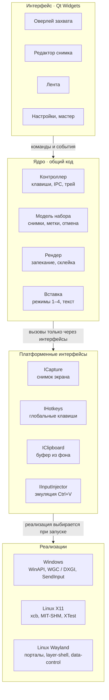

# ТЗ: аналог Snapik для Windows и Linux

Oct 19, 2026 · @Andrew

## 1. Разбор оригинала: что умеет Snapik

Snapik 1.9 — утилита для Windows 10/11 и macOS 14+. Она делает несколько скриншотов, ставит на них нумерованные метки с комментариями и вставляет всё в любой чат одним Ctrl+V. Цена — 19 € разово, первые 7 дней бесплатно. Версии для Linux нет. Ниже собрано всё, что видно на сайте, в условиях, политике конфиденциальности и в релизах на GitHub.

### Функции

| Функция | Как работает в Snapik | Источник |
| --- | --- | --- |
| Захват | Print Screen (Windows) или ⌥⌘S (Mac), клавишу можно переназначить. Экран «замирает», пользователь обводит нужную область | [сайт](https://getsnapik.com/ru) |
| Метки | Обведённая кнопка или блок получает метку A1, A2…: буква — номер снимка, цифра — место на нём. Рядом сразу открывается поле для комментария | [сайт](https://getsnapik.com/ru) |
| Лента снимков | Снимки копятся в маленькой ленте сбоку экрана, до 26 штук (A–Z). У каждого видно число комментариев, есть кнопка «Новый снимок» | [сайт](https://getsnapik.com/ru) |
| Вставка | Одно Ctrl+V / ⌘V вставляет в чат все снимки сразу, а под ними текст: «Снимок A», «A1 …», «A2 …», «Снимок B»… | [сайт](https://getsnapik.com/ru) |
| Куда вставлять | ChatGPT, Codex, Claude, Cursor, Telegram, WhatsApp — любой чат, принимающий картинки. Snapik ничего не отправляет сам | [сайт](https://getsnapik.com/ru) |
| Замазать | Провести по паролю или номеру карты, и в чат уйдёт размытая версия | [сайт](https://getsnapik.com/ru) |
| Обрезка и отмена | Обрезка снимка, Ctrl+Z отменяет любое число шагов (неверная рамка, размытие, обрезка) | [сайт](https://getsnapik.com/ru) |
| Приватность | Снимки, заметки и настройки хранятся локально. Наружу уходят только анонимные события (установка, конец пробного периода, активация) с версией программы и ОС, отключается в настройках | [privacy](https://getsnapik.com/privacy) |
| Лицензия | Ключ приходит на почту после оплаты через Lemon Squeezy и проверяется у них при активации. Одна покупка — два компьютера | [terms](https://getsnapik.com/terms) |
| Обновления | Windows обновляется сама с GitHub, есть каналы `win` и `beta`. Mac-версия пока не обновляется сама | [download](https://getsnapik.com/download) |

### Что видно по сборкам

Выводы ниже сделаны по файлам релиза [1.9.8](https://github.com/getsnapik/releases/releases/tag/1.9.8) и странице загрузки, исходников у Snapik нет.

- **Windows-установщик собран Velopack.** На это указывают `SnapikApp-win-Setup.exe`, `*-full.nupkg`, `releases.win.json` и канал `beta`. Велопак чаще всего используют с .NET, а установщик весит около 90 МБ — похоже на самодостаточное .NET-приложение.
- **Mac-версия — отдельная программа** в отдельном репозитории `releases-mac`, без автообновления. Скорее всего, это нативное приложение, а не общий кроссплатформенный код.
- **Вставка эмулирует нажатия клавиш.** На Mac для вставки через ⌘V нужно разрешение «Универсальный доступ». Оно требуется для синтеза клавиатурных событий. Значит, Snapik, вероятно, кладёт в буфер элементы по очереди и сам нажимает «вставить» для каждого.
- **Релизы частые:** 1.9.0 вышла 29 сентября 2026, 1.9.8 — 14 октября 2026.
- **Подписи кода нет.** Windows показывает предупреждение SmartScreen, macOS требует ручного разрешения на запуск.

## 2. Цель и границы проекта

Нужно сделать открытую (open source) десктопную программу для Windows 10/11 и Linux (X11 и Wayland) с тем же сценарием, что у Snapik: снял, отметил, подписал, вставил в чат одним действием. Рабочее название в документе — **Pointshot** (условное, менять можно).

**Linux — упор на Wayland.** Главная цель для Linux — сессия Wayland. В Fedora с версии 43 GNOME работает только на Wayland ([Linuxiac](https://linuxiac.com/fedora-43-drops-gnome-x11-support/)), KDE тоже по умолчанию на Wayland. Эталонная система для разработки и приёмки — **Fedora 44** (GNOME 50 и KDE Plasma 6.6, [вышла 28 апреля 2026](https://linuxiac.com/fedora-44-officially-released-this-is-whats-new/)). Каждая функция сначала делается и проверяется на Wayland. X11 поддерживается, но без гарантии одинаковых возможностей и без приоритета при исправлении ошибок.

**Главный критерий успеха:** пользователь проходит путь от нажатия клавиши до готового сообщения в ChatGPT или Telegram с тремя снимками и пятью комментариями быстрее чем за 60 секунд, не открывая отдельных окон-редакторов.

### Входит в MVP (версия 1.0)

- Захват области экрана по глобальной горячей клавише, которую пользователь назначает сам (по умолчанию Print Screen). Поддержка нескольких мониторов с разным масштабом.
- Прямоугольные метки с автонумерацией A1, A2… и поле комментария к каждой.
- Лента до 26 снимков (A–Z) с переходом между ними, удалением и пересъёмкой.
- Размытие (пикселизация) области, обрезка снимка, многошаговая отмена и повтор.
- Вставка всего набора в активный чат: последовательная вставка (основной режим) и запасные режимы — список файлов, перетаскивание, склейка в одно изображение.
- Значок в трее там, где трей есть, настройки, автозапуск, русский и английский интерфейс.
- Пакеты: Windows (Setup.exe с автообновлением и portable ZIP), Linux (.deb и .rpm).
- Открытый исходный код в публичном репозитории, лицензия GPL-3.0-or-later (раздел 11).

### Во второй очереди (1.x)

- Другие формы меток: стрелка, точка-маркер, произвольная линия.
- Шаблоны текста сообщения (например, вводная фраза для ИИ: «Исправь по пунктам…»).
- Сохранение набора в папку (PNG + Markdown) и история последних наборов.
- Пакеты AppImage и Flatpak, публикация на Flathub.
- Версия для macOS. В 1.0 её нет, но архитектура закладывает её с первого дня (разделы 8 и 9).

### Не входит

- Запись видео и GIF, OCR, облачное хранение и ссылки на снимки.
- Отправка сообщений от имени пользователя: программа только готовит вставку, «Отправить» нажимает человек.
- Платная версия, пробный период и ключи активации: проект распространяется бесплатно с открытым кодом.

## 3. Термины

| Термин | Значение |
| --- | --- |
| Снимок | Обрезанное изображение части экрана. Обозначается буквой A–Z в порядке создания |
| Метка | Отмеченная область на снимке с номером и комментарием. Идентификатор — буква снимка + порядковый номер: A1, A2, B1 |
| Комментарий | Текст, привязанный к метке. Может быть пустым — тогда в сообщение уходит только номер |
| Набор | Все снимки ленты с метками и комментариями. Это то, что вставляется в чат |
| Лента | Компактная панель у края экрана со списком снимков набора |
| Оверлей | Полноэкранное окно поверх «замороженного» снимка экрана, в котором выделяют область будущего снимка. Метки ставятся уже в окне редактирования |
| Запекание (render) | Наложение меток и размытия на пиксели снимка перед вставкой. Исходный снимок при этом не меняется |
| Последовательная вставка | Режим, в котором программа по очереди кладёт в буфер обмена каждый элемент набора и сама нажимает Ctrl+V |
| Портал | xdg-desktop-portal — стандартный D-Bus-интерфейс Linux, через который приложения на Wayland получают снимок экрана, глобальные клавиши и ввод |

## 4. Основной сценарий

Сценарий идёт по прямой, ветвление есть только на шаге 6.

1. Пользователь нажимает горячую клавишу (задаётся в настройках, по умолчанию Print Screen; особенности Linux — в разделе 9).
2. Программа снимает все мониторы и показывает оверлей с замороженной картинкой, слегка затемнённой. Курсор — перекрестье, рядом лупа с координатами.
3. Пользователь обводит область. Она становится снимком **A**, оверлей закрывается, появляется окно редактирования снимка с лентой: у края экрана там, где окно можно расположить, а на GNOME — там, где его поставит система.
4. В окне редактирования пользователь обводит кнопку — появляется метка **A1** и поле комментария с фокусом. Он пишет «Кнопку ярче», Enter закрепляет комментарий. Так же ставит A2, при необходимости размывает данные или обрезает.
5. Если нужен ещё экран — горячая клавиша или «Новый снимок» в ленте. Повторяются шаги 2–4, снимок получает букву **B**.
6. Пользователь переходит в чат и нажимает глобальную клавишу вставки набора. На Windows и X11 можно также нажать обычный Ctrl+V или кнопку «Вставить» в ленте.
   - **Последовательная вставка доступна** (Windows, X11 и Wayland там, где программа может менять буфер из фона и получила разрешение портала) — программа вставляет все снимки и затем текст.
   - **Недоступна** — программа предлагает запасной режим: перетащить набор из ленты в чат или вставить склеенное изображение с текстом.
7. Сообщение собрано в поле ввода. Пользователь при желании дописывает текст и сам нажимает «Отправить».
8. Лента предлагает «Очистить набор» — или очищается сама при следующем захвате, если так задано в настройках.

## 5. Функциональные требования

Приоритет: **M** — обязательно для 1.0, **S** — желательно для 1.0, **C** — во второй очереди.

### 5.1 Захват

| ID | Требование | Приоритет |
| --- | --- | --- |
| CAP-1 | Глобальная горячая клавиша запускает захват из любого приложения, программа при этом работает в фоне. Клавиша или сочетание задаётся в настройках, по умолчанию Print Screen. Если она занята системой или другой программой, приложение сообщает об этом и предлагает выбрать другую | M |
| CAP-2 | Снимается содержимое всех мониторов в момент нажатия. Оверлей появляется не позже чем через 300 мс | M |
| CAP-3 | Выделение области мышью: рамка, размеры в пикселях, лупа ×4 у курсора, перемещение и изменение рамки до подтверждения | M |
| CAP-4 | Подтверждение — отпускание мыши (быстрый режим) или Enter (точный режим), задаётся в настройках. Esc отменяет захват | M |
| CAP-5 | Подсветка окна под курсором и захват окна одним кликом (только Windows и X11) | S |
| CAP-6 | Захват на мониторах с разным масштабом (100–200 %) без размытия: снимок хранится в физических пикселях | M |
| CAP-7 | Запуск захвата из командной строки `pointshot --capture` в уже работающий экземпляр (нужно для Wayland-окружений без портала клавиш) | M |
| CAP-8 | Если в ленте уже 26 снимков, захват не начинается, лента подсвечивает сообщение «Набор заполнен» | M |

### 5.2 Метки и редактирование снимка

| ID | Требование | Приоритет |
| --- | --- | --- |
| EDT-1 | Прямоугольная метка рисуется протягиванием мыши. Сразу после неё появляется поле комментария с фокусом | M |
| EDT-2 | Нумерация автоматическая: A1, A2… При удалении метки номера остальных пересчитываются без пропусков | M |
| EDT-3 | Значок номера — круг акцентного цвета с белой цифрой у левого верхнего угла рамки, не выходит за край снимка | M |
| EDT-4 | Метку можно перемещать, менять размер, удалять (Delete), редактировать её комментарий двойным кликом | M |
| EDT-5 | Комментарий — одна или несколько строк до 500 символов. Enter сохраняет, Shift+Enter — перенос строки | M |
| EDT-6 | Размытие: протягиванием выделяется прямоугольник, внутри — пикселизация с блоком 12 px. Исходные пиксели в отданное изображение не попадают | M |
| EDT-7 | Обрезка снимка с сохранением меток. Метки, оказавшиеся вне области, удаляются после подтверждения | M |
| EDT-8 | Отмена и повтор (Ctrl+Z / Ctrl+Shift+Z) без ограничения глубины в пределах набора, включая удаление снимка | M |
| EDT-9 | Стрелка и точка-маркер как альтернативные формы метки | C |
| EDT-10 | Подписи комментариев прямо на картинке (опция «текст на изображении») | C |

### 5.3 Лента

| ID | Требование | Приоритет |
| --- | --- | --- |
| STR-1 | Плавающая панель у края экрана поверх окон: миниатюры снимков с буквой и числом комментариев. В GNOME «поверх окон» и выбор позиции недоступны — там лента обычное окно (раздел 9) | M |
| STR-2 | Кнопки «Новый снимок», «Вставить набор», «Очистить». Счётчик «3 снимка · 4 комментария» | M |
| STR-3 | Клик по миниатюре открывает снимок на редактирование. Перетаскивание меняет порядок, буквы пересчитываются | S |
| STR-4 | Удаление снимка с пересчётом букв последующих снимков и всех меток | M |
| STR-5 | Ленту можно свернуть в значок и перетащить к другому краю, положение запоминается. Только Windows, X11 и композиторы с layer-shell | S |
| STR-6 | Перетаскивание набора или одного снимка из ленты в другое приложение как файлов (drag-and-drop) | M |

### 5.4 Вставка набора

| ID | Требование | Приоритет |
| --- | --- | --- |
| PST-1 | Режим «последовательная вставка»: картинки A, B, C… по очереди, затем текст. Подробности — раздел 10 | M |
| PST-2 | Запуск вставки: глобальная клавиша вставки набора (везде), перехват обычного Ctrl+V при непустом наборе и включённой опции (только Windows и X11), кнопка в ленте (режим 1 — только Windows и X11, на Wayland кнопка копирует набор в режиме 2). Клавиша по умолчанию не должна быть Ctrl+Shift+V: это вставка в терминалах и «вставить как текст» в браузерах, где картинки теряются. Кандидат — Ctrl+Alt+V, выбирается на прототипе | M |
| PST-3 | Текст сообщения формируется по шаблону. По умолчанию — «Снимок A», затем строки «A1 комментарий», пустая строка между снимками | M |
| PST-4 | Режим «файлы + текст»: в буфер одновременно кладутся список PNG-файлов и текст, вставка одним нативным Ctrl+V | M |
| PST-5 | Режим «склейка»: все снимки собираются в одно изображение по вертикали с подписями A, B, C; текст идёт вторым элементом | M |
| PST-6 | Предпросмотр того, что уйдёт в чат: запечённые картинки и итоговый текст | S |
| PST-7 | Сжатие: PNG по умолчанию, JPEG 85 % при размере больше 5 МБ, ограничение длинной стороны 4096 px (настраиваемо) | S |
| PST-8 | После вставки исходное содержимое буфера обмена восстанавливается | S |
| PST-9 | Программа никогда сама не нажимает Enter и не отправляет сообщение | M |

### 5.5 Приложение и настройки

| ID | Требование | Приоритет |
| --- | --- | --- |
| APP-1 | Работа в фоне со значком в трее: «Снять», «Показать ленту», «Настройки», «Выход». В GNOME (Fedora Workstation) трея без расширений нет, поэтому программа полностью управляется и без него: повторный запуск из меню приложений открывает ленту и настройки, захват и вставка — по глобальным клавишам | M |
| APP-2 | Только один экземпляр. Повторный запуск передаёт команду работающему экземпляру | M |
| APP-3 | Настройки: клавиши, режим вставки, шаблон текста, акцентный цвет меток, формат картинок, автозапуск, язык, автоочистка | M |
| APP-4 | Мастер первого запуска: проверка захвата, клавиш и вставки на текущей системе, подсказки для Wayland | M |
| APP-5 | Интерфейс на русском и английском, выбор по языку системы | M |
| APP-6 | Сохранение набора в папку: PNG-файлы и `message.md` | C |
| APP-7 | Автоматическая установка обновлений на Windows. На Linux — уведомление о новой версии, обновление через пакетный менеджер | S |

## 6. Нефункциональные требования

| ID | Область | Требование |
| --- | --- | --- |
| NFR-1 | Скорость | От горячей клавиши до оверлея — не более 300 мс на 2 мониторах 4K на Windows и X11, не более 800 мс на Wayland: там снимок идёт через портал, цифра уточняется на прототипе. Вставка набора из 5 снимков — не более 3 с |
| NFR-2 | Ресурсы | В фоне: до 60 МБ ОЗУ и 0 % CPU. С полным набором из 26 снимков 4K — до 600 МБ. Для этого исходники хранятся сжатыми (PNG в памяти), а в несжатом виде держится только снимок, открытый в редакторе: 26 несжатых кадров 4K занимают около 860 МБ |
| NFR-3 | Размер | Установщик Windows — до 40 МБ. Пакеты .deb и .rpm без встроенного Qt — до 5 МБ |
| NFR-4 | Приватность | Снимки и комментарии не покидают компьютер, кроме вставки самим пользователем. Телеметрии нет. Снимки не попадают в историю буфера обмена и облачную синхронизацию буфера (раздел 10). Единственный сетевой запрос — проверка новой версии в GitHub Releases, отключается в настройках |
| NFR-5 | Хранение | Набор держится в памяти. При включённой опции «пережить перезапуск» — в каталоге данных пользователя с правами 0700 (Linux) или в %LOCALAPPDATA% (Windows) |
| NFR-6 | Платформы | Windows 10 22H2 и Windows 11 x64. Linux x86_64. Эталон — Fedora 44 на Wayland (.rpm): GNOME 50, KDE Plasma 6.6, Sway Spin. Дополнительно: .deb для Ubuntu 24.04+ и Debian 12+, .rpm для openSUSE Tumbleweed. X11 — без гарантии одинаковых возможностей |
| NFR-7 | Качество | Снимки без потерь (PNG), размытие необратимо, координаты меток в физических пикселях |
| NFR-8 | Надёжность | Сбой захвата или вставки не роняет программу, пользователь видит понятное сообщение и запасной вариант |
| NFR-9 | Доступность | Все действия доступны с клавиатуры. Контраст значков меток не ниже 4.5:1 |
| NFR-10 | Локализация | Все строки во внешних файлах перевода. Шаблон текста сообщения локализуется отдельно от интерфейса |
| NFR-11 | Переносимость | В ядре и интерфейсе нет кода под конкретную ОС: никаких `#ifdef _WIN32` вне каталога `platform/`. Пути — через `QStandardPaths`, клавиши — через абстракцию «основной модификатор» (Ctrl на Windows и Linux, ⌘ на macOS). Добавление macOS не требует правок ядра |
| NFR-12 | Открытость | Сборка из исходников одной командой CMake на чистой системе. Все зависимости — свободные и есть в репозиториях целевых дистрибутивов |

## 7. Стек

**Решение: C++20 + Qt 6 (Widgets и QPainter), сборка CMake, тонкий платформенный слой на WinAPI, xcb и D-Bus-порталах.** Вся логика, редактор, лента и рендер — общий код. Платформенный код ограничен четырьмя интерфейсами: захват, горячие клавиши, буфер обмена, эмуляция ввода.

### Почему Qt

- **Wayland без XWayland.** У Qt зрелый нативный Wayland-клиент, а это главная сложность проекта: полноэкранный оверлей, буфер обмена, масштаб мониторов.
- **Буфер обмена с несколькими форматами сразу.** `QMimeData` кладёт в одну запись `image/png`, `text/uri-list` (на Windows — CF_HDROP), `text/html` и `text/plain`. Это нужно для режима «файлы + текст».
- **Рисование.** QPainter даёт сглаженные рамки, значки, пикселизацию и быстрый вывод картинок 4K без WebView.
- **D-Bus из коробки.** QtDBus позволяет вызывать порталы Screenshot, GlobalShortcuts и RemoteDesktop без лишних зависимостей.
- **Размер.** Установщик с нужными модулями (Core, Gui, Widgets, DBus, WaylandClient) укладывается в 25–40 МБ — меньше, чем ~90 МБ у оригинала.
- **Лицензия.** Qt под LGPLv3 совместим с открытой лицензией проекта GPL-3.0-or-later, а сам Qt уже есть в репозиториях всех целевых дистрибутивов.

Версии Qt разные для двух платформ. На Windows Qt поставляется вместе с программой, берётся свежая версия 6.10 или новее (на октябрь 2026 актуальна 6.12, [Qt Releases](https://doc.qt.io/qt-6/qt-releases.html)). На Linux пакеты .deb и .rpm используют системный Qt, поэтому минимальная версия — 6.4: столько в Ubuntu 24.04 ([qt6-base-dev 6.4.2](https://packages.ubuntu.com/noble/qt6-base-dev)) и Debian 12. Код не должен использовать API новее Qt 6.4, это проверяется сборкой в CI на Ubuntu 24.04.

### Рассмотренные варианты

| Стек | Плюсы | Минусы | Итог |
| --- | --- | --- | --- |
| **C++20 + Qt 6** | Нативный Wayland, полный контроль над буфером и окнами, малый размер | Нужен опытный C++/Qt-разработчик, дольше писать UI | **Выбран** |
| .NET 9 + Avalonia | Скорее всего, близко к оригиналу (Velopack, ~90 МБ). Быстрая разработка на C# | Wayland-поддержка менее зрелая, порталы и xcb — через P/Invoke и сторонние библиотеки, размер больше | Запасной, если команда на C# |
| Rust + Tauri 2 | Небольшой размер, безопасный язык, готовые крейты для захвата и буфера | Интерфейс в WebKitGTK на Linux: прозрачный полноэкранный оверлей и много окон работают нестабильно, буфер с несколькими форматами — своими силами | Не выбран |
| Electron | Самый быстрый UI на веб-технологиях | 100+ МБ, высокое потребление памяти, те же проблемы Wayland, нарушает NFR-2 и NFR-3 | Не выбран |
| Flutter Desktop | Красивый UI | Слабая поддержка многооконности и оверлеев, мало готового для буфера и порталов | Не выбран |

### Состав стека

| Слой | Технология |
| --- | --- |
| Язык и сборка | C++20, CMake 3.28+, Ninja. На Linux — только системные пакеты, на Windows — Qt через aqtinstall, остальное через vcpkg |
| UI | Qt Widgets + QPainter: оверлей, редактор, лента, настройки |
| Windows | WinAPI: `RegisterHotKey`, `SetWindowsHookEx(WH_KEYBOARD_LL)`, `SendInput`, захват через Qt / GDI `BitBlt` или DXGI Desktop Duplication |
| Linux X11 | xcb + xcb-xtest: `XGrabKey`, эмуляция Ctrl+V, захват через `xcb_get_image` / MIT-SHM |
| Linux Wayland | QtDBus → xdg-desktop-portal: Screenshot, ScreenCast (вариант быстрого захвата), GlobalShortcuts, RemoteDesktop, Clipboard, FileTransfer. Протоколы `ext-data-control-v1` / `wlr-data-control` и `virtual-keyboard-v1` — через отдельное подключение libwayland-client и wayland-scanner, как в wl-clipboard. Layer-shell для окон Qt — через LayerShellQt под Qt 6: он есть в Fedora 44 вместе с Plasma 6.6. Зависимость необязательная: без неё оверлей и лента работают как обычные окна. Свою реализацию layer-shell на окнах Qt не делаем — роль поверхности назначает плагин оболочки Qt через приватный API |
| macOS (задел) | Каталог `platform/macos/` с заглушками интерфейсов, CMake-цель собирается в CI, но не выпускается (раздел 9) |
| Изображения | QImage (PNG, JPEG), своя пикселизация |
| Настройки | QSettings (INI) в каталоге конфигурации пользователя |
| Логи | spdlog с ротацией, без содержимого снимков |
| Тесты | GoogleTest для модели и рендера, Qt Test для UI, эталонные PNG для запекания |
| Пакеты | Windows — Velopack (Setup.exe с автообновлением, portable ZIP). Linux — CPack (.deb и .rpm) |
| CI | GitHub Actions: windows-2022, ubuntu-24.04, fedora (контейнер), macos (только сборка). Публикация в GitHub Releases |

## 8. Архитектура

Программа — один процесс с четырьмя слоями. Интерфейс и ядро не знают, на какой системе работают: всё платформенное спрятано за четырьмя интерфейсами, а нужная реализация выбирается при запуске.



Ядро общается с платформой только через ICapture, IHotkeys, IClipboard и IInputInjector. Новую платформу (например, macOS) можно добавить, не трогая интерфейс и ядро.

### Модули

| Модуль | Отвечает за | Ключевые классы |
| --- | --- | --- |
| Контроллер | Запуск, единственный экземпляр (QLocalServer), трей, команды от клавиш и CLI | `AppController`, `SingleInstance`, `TrayMenu` |
| Модель набора | Снимки, метки, комментарии, нумерация, история отмен на `QUndoStack` | `CaptureSet`, `Shot`, `Mark`, `Redaction` |
| Оверлей | Замороженный экран на каждом мониторе, выделение области, лупа | `CaptureOverlay`, `ScreenFrame` |
| Редактор | Рисование меток, поле комментария, размытие, обрезка | `ShotEditor`, `MarkItem`, `CommentPopup` |
| Лента | Миниатюры, перестановка, перетаскивание наружу, запуск вставки | `StripWindow`, `ShotThumb` |
| Рендер | Запекание меток и размытия, склейка, сжатие | `ShotRenderer`, `Composer`, `ImageEncoder` |
| Вставка | Шаблон текста, режимы 1–4, профили задержек, восстановление буфера | `MessageBuilder`, `PasteOrchestrator`, `AppProfiles` |
| Платформа | Реализации четырёх интерфейсов, определение окружения | `PlatformFactory`, `WinCapture`, `X11Hotkeys`, `PortalScreenshot`, `WlDataControlClipboard` |

### Модель данных

```cpp
struct Mark {
    QUuid id;
    QRect rect;            // в физических пикселях исходника
    QString comment;       // до 500 символов
};                         // номер = позиция в Shot::marks + 1

struct Redaction {
    QRect rect;            // область пикселизации
};

struct Shot {
    QUuid id;
    QByteArray sourcePng;  // исходник без меток, сжатый (NFR-2)
    QSize sourceSize;
    qreal devicePixelRatio;
    QRect crop;            // обрезка без потери исходника, для отмены
    QList<Mark> marks;
    QList<Redaction> redactions;
};                         // буква = позиция в CaptureSet::shots

struct CaptureSet {
    QList<Shot> shots;     // не больше 26
};
```

Номер метки и буква снимка не хранятся, а вычисляются из позиции в списке. Так перестановка, удаление и отмена не могут оставить рассинхронизированные номера. Обрезка не меняет исходник, а хранится как прямоугольник: её можно отменить без копии кадра.

### Потоки

- Интерфейс, модель и вызовы платформы — в главном потоке Qt. Ожидание ответов — асинхронно, через `QFuture` и сигналы, без блокировок и вложенных циклов событий.
- Тяжёлая работа — декодирование кадра из портала, нарезка по мониторам, запекание, кодирование PNG — в пуле потоков `QtConcurrent`. `QScreen::grabWindow` вызывается только из главного потока, как требует Qt.
- Последовательная вставка — конечный автомат на `QTimer` в главном потоке.
- Подключение libwayland-client для data-control и virtual-keyboard обслуживается через `QSocketNotifier` в главном потоке.

### Платформенные интерфейсы

Все четыре интерфейса асинхронные: на Wayland за вызовом может стоять диалог портала, и ответ приходит через секунды или не приходит вовсе. Режим вставки ядро выбирает по заявленным возможностям (`capabilities()`), а не по названию ОС — так новая платформа или новый композитор не требуют правок ядра.

```cpp
class ICapture : public QObject {
    Q_OBJECT
public:
    virtual QFuture<CaptureResult> captureAllScreens() = 0; // кадр + геометрия и масштаб мониторов
    virtual CaptureCaps capabilities() const = 0;            // окно под курсором и т. п.
};

class IHotkeys : public QObject {
    Q_OBJECT
public:
    // Фактическое сочетание может отличаться: на Wayland его подтверждает пользователь
    virtual QFuture<BindResult> bind(Action action, const QKeySequence &preferred) = 0;
signals:
    void activated(Action action, const ActivationContext &ctx); // токен активации, если есть
    void released(Action action);                                 // клавиша отпущена
};

class IClipboard : public QObject {
    Q_OBJECT
public:
    virtual bool canWriteInBackground() const = 0;
    virtual QFuture<void> write(const ClipboardPayload &data, ClipboardFlags flags) = 0; // флаги: не в историю, не в облако
    virtual QFuture<ClipboardPayload> snapshot() = 0;  // для восстановления после вставки
};

class IInputInjector : public QObject {
    Q_OBJECT
public:
    virtual QFuture<void> waitModifiersReleased(std::chrono::milliseconds timeout) = 0;
    virtual QFuture<void> sendPaste() = 0;              // по коду клавиши V, не по символу
    virtual bool canDetectForegroundChange() const = 0; // на Wayland — false
};
```

## 9. Платформенные особенности

Windows и Linux X11 дают всё нужное напрямую. На Wayland каждая возможность идёт через портал или протокол композитора, и на GNOME часть из них недоступна. Поэтому программа при старте определяет окружение (`XDG_SESSION_TYPE`, `XDG_CURRENT_DESKTOP`, список глобальных объектов Wayland, версии порталов) и включает доступные механизмы.

### Приоритет: Wayland на Fedora 44

Эталонные окружения — три редакции Fedora 44, все на Wayland. Самое сложное из них — Workstation с GNOME: это редакция Fedora по умолчанию, и именно в ней меньше всего возможностей для фоновой вставки.

| Редакция Fedora 44 | Композитор | Буфер из фона | Ожидаемый режим вставки |
| --- | --- | --- | --- |
| Workstation | GNOME 50 (Mutter) | Нет `ext-data-control-v1` ([wayland.app](https://wayland.app/protocols/ext-data-control-v1)). Проверить портал Clipboard | Режимы 2–4. Режим 1 — если подтвердится портал Clipboard |
| KDE Plasma Desktop | Plasma 6.6 (KWin) | `ext-data-control-v1` заявлен для актуального KWin. Проверить на 6.6 | Режим 1, запасные 2–4 |
| Sway Spin | Sway | `ext-data-control-v1` | Режим 1, клавиша через конфиг Sway |

Требования к Wayland-версии:

- **Только нативный Wayland.** В сессии Wayland программа работает через Qt-платформу `wayland`, а не через XWayland. Под XWayland не работают глобальные клавиши и захват чужих окон, поэтому при таком запуске программа показывает предупреждение.
- **Идентификатор приложения.** Программы вне Flatpak порталы узнают по имени systemd-юнита (`app-<id>-….scope`) или по явной регистрации через `org.freedesktop.host.portal.Registry` ([подробнее](https://blogs.gnome.org/ignapk/?p=69)). Без идентификатора порталы не могут связать с программой выданные разрешения и токены восстановления. Поэтому программа регистрируется первым же вызовом порталов, а идентификатор совпадает с именем .desktop-файла (раздел 11).
- **Портал Clipboard — гипотеза для GNOME.** Портал `org.freedesktop.portal.Clipboard` даёт сессии RemoteDesktop доступ к буферу: программа объявляет MIME-типы и отдаёт данные по запросу без фокуса ([документация](https://flatpak.github.io/xdg-desktop-portal/docs/doc-org.freedesktop.portal.Clipboard.html)). Доступ запрашивается до старта сессии. Если бэкенд GNOME 50 его поддерживает, последовательная вставка заработает и в Workstation. Это проверяется в первую неделю прототипа.
- **Фокус оверлея на GNOME.** Окно, открытое по глобальной клавише, GNOME может не активировать из-за защиты от кражи фокуса. Тогда мышь работает, а Esc и Enter — нет. Если портал GlobalShortcuts передаёт токен xdg-activation, программа им пользуется. Поведение проверяется на прототипе.
- **Скорость захвата.** Портал Screenshot отдаёт PNG всего экрана через файл, на 2×4K это сотни миллисекунд. На прототипе сравниваются ускорения: сессия портала ScreenCast (PipeWire) и на KDE — интерфейс KWin ScreenShot2 для программ, объявленных доверенными в .desktop-файле.
- **Сессия RemoteDesktop — на время вставки.** Пока сессия открыта, GNOME показывает индикатор удалённого управления. Поэтому она открывается по токену восстановления перед вставкой и сразу закрывается, а не держится постоянно.
- **Запасные режимы — полноценные, а не аварийные.** На GNOME режимы «файлы + текст» и перетаскивание из ленты должны быть удобными по умолчанию: крупная кнопка «Скопировать набор» в ленте, подсказка «теперь нажмите Ctrl+V в чате».
- **Одно окно мастера на все разрешения.** Скриншот, глобальная клавиша и RemoteDesktop запрашиваются подряд при первом запуске, токены восстановления сохраняются, чтобы диалоги не повторялись.
- **Масштаб.** Дробное масштабирование Wayland (125 %, 150 %, 175 %) и мониторы с разным масштабом — обязательные сценарии, координаты меток считаются в физических пикселях снимка. В Qt 6.4 (Ubuntu 24.04, Debian 12) нет поддержки протокола дробного масштаба, она появилась около Qt 6.5. Там интерфейс программы может быть размытым, на Fedora 44 этой проблемы нет.

### Матрица возможностей

| Возможность | Windows 10/11 | Linux X11 | Wayland: KDE Plasma 6 | Wayland: GNOME | Wayland: Sway, Hyprland |
| --- | --- | --- | --- | --- | --- |
| Снимок экрана | Windows.Graphics.Capture или DXGI, GDI как запасной | xcb, без разрешений | Портал Screenshot. Быстрее — KWin ScreenShot2 для доверенных программ | Портал Screenshot (первый раз — запрос разрешения) или сессия ScreenCast | Портал Screenshot (-wlr / -hyprland) или `ext-image-copy-capture` |
| Глобальная клавиша | `RegisterHotKey`, для Print Screen — хук `WH_KEYBOARD_LL` | `XGrabKey` | Портал GlobalShortcuts | Портал GlobalShortcuts с GNOME 48 ([TWIG #189](https://thisweek.gnome.org/posts/2025/02/twig-189)). В GNOME 46–47 (Ubuntu 24.04) — своё сочетание в настройках GNOME на `pointshot --capture` | Hyprland — портал. Sway — привязка в конфиге к `pointshot --capture` |
| Оверлей поверх всего | Окно без рамки, topmost | Окно `_NET_WM_STATE_FULLSCREEN` + above | Layer-shell (LayerShellQt) | Полноэкранное окно на каждом мониторе | Layer-shell, если собран с LayerShellQt, иначе полноэкранные окна |
| Фокус оверлея после клавиши | Да | Да | Да | Не гарантирован (защита от кражи фокуса). Нужен токен активации — проверить | Да |
| Лента поверх окон | Topmost-окно | Окно с флагом «поверх» | Layer-shell | **Невозможно** для обычного окна. Лента — обычное маленькое окно | Layer-shell |
| Значок в трее | Да | Да | Да | **Нет** без расширения AppIndicator | Зависит от панели (swaybar, waybar — да) |
| Смена буфера из фона | Да | Да | `ext-data-control-v1` (проверить на 6.6) или портал Clipboard | **Нет** data-control. Портал Clipboard — проверить | `ext-data-control-v1` / `wlr-data-control` |
| Эмуляция Ctrl+V | `SendInput` | XTest | Портал RemoteDesktop | Портал RemoteDesktop | `virtual-keyboard-v1` |
| Перехват обычного Ctrl+V | Хук `WH_KEYBOARD_LL` | `XGrabKey` на время активного набора | Нет — отдельная клавиша вставки | Нет — отдельная клавиша вставки | Нет — отдельная клавиша вставки |
| Активное окно (профили задержек, контроль смены окна) | Да | Да | Нет | Нет | Нет |
| Последовательная вставка | Да | Да | Да | Только если подтвердится портал Clipboard, иначе режимы 2–4 | Да |

### Windows

- **Print Screen.** В Windows 11 клавиша по умолчанию открывает «Ножницы», и `RegisterHotKey` её не получит. Нужен хук `WH_KEYBOARD_LL`, который глотает нажатие. Мастер первого запуска предлагает отключить параметр «Использовать Print Screen для открытия Ножниц».
- **Масштаб.** Процесс работает в режиме Per-Monitor DPI Aware v2 (у Qt 6 по умолчанию). Координаты оверлея считаются в физических пикселях каждого монитора.
- **Захват.** Основной путь — Windows.Graphics.Capture: он корректно снимает HDR-мониторы, а GDI `BitBlt` даёт на них выцветшую картинку. На Windows 10 этот API рисует жёлтую рамку вокруг захвата, отключить её можно только в Windows 11, поэтому там основной путь — DXGI Desktop Duplication.
- **Свои нажатия.** Хук `WH_KEYBOARD_LL` видит и эмулированные события. Нажатия с флагом `LLKHF_INJECTED` пропускаются, иначе программа перехватит собственный Ctrl+V. Хук ставится, только пока он нужен, ничего не пишет в лог и отвечает мгновенно: медленный хук Windows молча отключает.
- **История буфера.** Записи с картинками помечаются форматами `ExcludeClipboardContentFromMonitorProcessing`, `CanIncludeInClipboardHistory = 0` и `CanUploadToCloudClipboard = 0`. Иначе снимки попадут в историю Win+V и в облачную синхронизацию буфера.
- **Повышенные права.** `SendInput` не может вставлять в окна, запущенные от администратора (UIPI). В этом случае программа показывает подсказку и переключается на режим «файлы + текст».
- **SmartScreen.** Установщик подписывается через SignPath Foundation (раздел 11), иначе Windows показывает предупреждение, как у оригинала.

### Linux X11

- Захват всего корневого окна через MIT-SHM, затем нарезка по мониторам из XRandR.
- Клавиша Print Screen часто занята окружением (GNOME, KDE на X11). Клавиша захвата — настраиваемый параметр: мастер проверяет, свободна ли она, и предлагает выбрать другую или отключить системную.
- Буфер обмена в X11 живёт, пока жив процесс-владелец. Программа остаётся владельцем, пока набор не очищен.

* **Свои нажатия.** Перед эмуляцией Ctrl+V через XTest захват клавиши (`XGrabKey`) снимается, иначе программа перехватит собственное нажатие. После вставки захват возвращается.

### Linux Wayland

- **Снимок.** Портал Screenshot с `interactive=false` возвращает файл со всем экраном. Программа читает его, сразу удаляет и показывает свой оверлей поверх.
- **Оверлей на GNOME.** Без layer-shell оверлей — это полноэкранное окно на каждом мониторе. Анимацию появления окон в GNOME программа отключить не может, поэтому оверлей может открываться с короткой анимацией поверх живого экрана. Насколько это заметно, проверяется на прототипе.
- **Портал RemoteDesktop.** Запрашивается только для клавиатуры, с `persist_mode=2`, чтобы диалог разрешения появился один раз. Токен восстановления хранится в настройках.
- **Без порталов.** На минимальных окружениях без xdg-desktop-portal программа сообщает, чего не хватает, и предлагает CLI-команды для привязки клавиш.
- **Flatpak.** В 1.0 не выпускается. Когда появится, в песочнице будут работать только порталы, и data-control с virtual-keyboard придётся отключить. Полный набор возможностей — в пакетах .deb и .rpm.

* **Клавиша через портал.** На GNOME и KDE программа предлагает порталу GlobalShortcuts сочетание из настроек, а окончательно его подтверждает и может поменять пользователь в системном диалоге. Настройки программы показывают фактически назначенное сочетание.

### macOS — задел, не входит в 1.0

Версия для macOS может понадобиться позже, поэтому её путь закладывается сейчас. Ядро и интерфейс не меняются, добавляется только каталог `platform/macos/` с четырьмя реализациями.

| Интерфейс | macOS API | Особенность |
| --- | --- | --- |
| ICapture | ScreenCaptureKit (`SCScreenshotManager`) | Разрешение «Запись экрана» при первом захвате |
| IHotkeys | Carbon `RegisterEventHotKey` | Разрешений не требует |
| IClipboard | `NSPasteboard` | Писать в буфер можно из фона, ограничений как на GNOME нет |
| IInputInjector | `CGEventPost` (⌘V) | Разрешение «Универсальный доступ», как у оригинала Snapik |

Что делаем уже в 1.0, чтобы перенос занял недели, а не месяцы:

- CMake-цель для macOS собирается в CI с заглушками интерфейсов. Сборка не должна ломаться.
- Модификатор вставки и сочетания клавиш хранятся в настройках в переносимом виде (`Primary+Shift+V`), а не как Ctrl.
- Мастер первого запуска умеет показывать шаги выдачи системных разрешений — на macOS их два, на Wayland — порталы.
- Иконки, переводы и шаблон сообщения не привязаны к платформе.

Для выпуска понадобятся .dmg через macdeployqt, подпись и нотаризация Apple (платный аккаунт разработчика, 99 $ в год) — это решается отдельно.

## 10. Вставка набора и буфер обмена

Буфер обмена не умеет хранить «несколько картинок и текст» так, чтобы любой чат вставил их одним Ctrl+V. Поэтому основной режим — последовательная вставка: программа сама кладёт элементы в буфер по одному и нажимает Ctrl+V за пользователя. Остальные режимы — запасные.

### Текст сообщения

Шаблон по умолчанию (русская локаль). Пустые комментарии дают строку только с номером, снимки без меток дают только заголовок.

```markdown
Снимок A
A1 Кнопку «Купить» ярче
A2 Цену на карточках крупнее

Снимок B
B1 Убрать этот блок
```

Настраиваются: заголовок снимка, формат строки метки (`{id} {text}`, `{id}: {text}`, `**{id}** {text}`), вводная фраза в начале и в конце, а также место текста — после картинок или перед ними.

### Режим 1. Последовательная вставка (основной)

1. Пользователь запускает вставку: Ctrl+V при активном наборе (Windows, X11), отдельная клавиша или кнопка в ленте. Кнопка в ленте запускает режим 1 только на Windows и X11: там программа может вернуть фокус окну, которое было активно до этого. На Wayland вернуть фокус чужому окну нельзя, поэтому режим 1 запускается только глобальной клавишей из окна чата, а кнопка копирует набор в режиме 2.
2. Программа сохраняет текущее содержимое буфера обмена.
3. Для каждого снимка по порядку: запечь метки и размытие, положить PNG в буфер, подождать 80 мс, эмулировать Ctrl+V, подождать задержку профиля (по умолчанию 400 мс).
4. Положить в буфер текст сообщения и эмулировать Ctrl+V.
5. Через 1 с вернуть исходное содержимое буфера.
6. Во время вставки поверх ленты виден индикатор «Вставляю 2 из 4», Esc прерывает процесс. Если активное окно сменилось, вставка останавливается (на Windows и X11; на Wayland смену окна отследить нельзя).

Правила эмуляции ввода:

- **Отпущенные модификаторы.** Перед первым Ctrl+V программа ждёт, пока пользователь отпустит клавиши сочетания (сигнал `released`, на Wayland — `Deactivated` портала GlobalShortcuts), и ещё 50 мс. Иначе зажатый Shift или Alt превратит эмулированный Ctrl+V в другое сочетание.
- **Код клавиши, а не символ.** V нажимается по коду клавиши: `VK_V` на Windows, keycode 55 в X11, `KEY_V` в evdev для порталов. При русской раскладке символа «v» нет, и эмуляция по символу не сработает или переключит раскладку.
- **Раскладка виртуальной клавиатуры.** `virtual-keyboard-v1` требует передать композитору раскладку. Передаётся стандартная `us` только для виртуального устройства, побочные эффекты для раскладки пользователя проверяются на Sway.
- **Свои события.** Перехватчики Ctrl+V на Windows и X11 пропускают нажатия, которые эмулирует сама программа (раздел 9).

Задержки берутся из профиля приложения, определённого по активному окну (имя процесса на Windows, `WM_CLASS` на X11). На Wayland активное окно узнать нельзя, используется общий профиль.

| Профиль | Задержка между картинками | Особенность |
| --- | --- | --- |
| По умолчанию | 400 мс | — |
| Браузеры (ChatGPT, Claude) | 600 мс | Загрузка картинки идёт асинхронно, слишком быстрая вставка теряет элементы |
| Telegram Desktop | 300 мс | Ожидается, что первая картинка откроет окно отправки, следующие добавятся в альбом, а текст уйдёт в подпись. Проверяется на прототипе |
| Cursor, VS Code | 400 мс | — |

Значения задержек — стартовые, их уточняют на прототипе (раздел 12).

### Режим 2. Файлы + текст

Одна запись в буфере сразу с несколькими форматами. Программа пишет PNG во временную папку и кладёт:

- `text/uri-list` (на Windows — CF_HDROP) — список файлов;
- `x-special/gnome-copied-files` — для файловых менеджеров GNOME;
- `text/plain` — текст сообщения;
- `image/png` — первый снимок, для приложений, которые принимают только одну картинку.

Это работает одним нативным Ctrl+V, но каждое приложение выбирает из записи свой формат. Часть программ возьмёт файлы и проигнорирует текст, часть — наоборот. Режим используется на GNOME Wayland и при ошибке эмуляции ввода. Временные файлы удаляются при очистке набора и при выходе.

**Программы в песочнице.** Telegram Desktop из Flathub и браузеры в Snap или Flatpak не видят файлы во временной папке программы, поэтому список файлов из режимов 2 и 3 в них не вставится. Файлы дополнительно передаются через портал FileTransfer: программа регистрирует их в портале и кладёт в запись ключ `application/vnd.portal.filetransfer`, по которому получатель открывает файлы. Поддержка на стороне получателя разная и проверяется на прототипе. Если её нет, для таких программ остаются режим 1 (картинки через буфер, без файлов) и склейка.

### Режим 3. Перетаскивание

Из ленты набор перетаскивается в окно чата как список файлов. Это самый совместимый способ для браузеров и Telegram на любом окружении. Текст при этом копируется в буфер, и подсказка предлагает вставить его вторым действием.

### Режим 4. Склейка

Все снимки собираются в одно изображение по вертикали, с отступом 16 px и буквой над каждым. Вставляются две записи: картинка, затем текст. Подходит для чатов, где разрешена одна картинка на сообщение.

### Запекание

- Рамка метки — 3 px акцентного цвета (по умолчанию #FF5A1F) с белой обводкой 1 px для контраста на любом фоне.
- Значок номера — круг 28 px с текстом «A1» белым полужирным, масштабируется по DPI снимка.
- Размытие — пикселизация блоками 12 px, применяется до рисования меток.
- Если длинная сторона больше 4096 px, снимок уменьшается. Если PNG больше 5 МБ, он кодируется в JPEG 85 %.

### Буфер обмена и приватность

- **Windows.** Записи помечаются форматами, которые исключают их из истории Win+V и облачной синхронизации (раздел 9).
- **KDE.** К записи добавляется `x-kde-passwordManagerHint` со значением `secret`, тогда Klipper её не сохраняет.
- **GNOME и другие менеджеры буфера на Wayland** видят все записи, общего способа скрыть запись нет. Это сказано в справке, а восстановление исходного буфера (PST-8) сокращает время, пока снимок лежит в буфере.
- **Восстановление.** Возвращаются только текст и картинки. Если в буфере был формат, который программа не умеет прочитать (файлы из файлового менеджера, данные офисных программ), он не восстанавливается, и пользователь видит подсказку.

## 11. Настройки, данные, сборка и обновления

### Где хранятся данные

| Что | Windows | Linux |
| --- | --- | --- |
| Настройки (INI) | `%APPDATA%\Pointshot\settings.ini` | `$XDG_CONFIG_HOME/pointshot/settings.ini` |
| Набор при опции «пережить перезапуск» | `%LOCALAPPDATA%\Pointshot\session\` | `$XDG_DATA_HOME/pointshot/session/` (права 0700) |
| Временные PNG для режима «файлы + текст» | `%TEMP%\pointshot-<pid>\` | `$XDG_RUNTIME_DIR/pointshot/` |
| Логи (без содержимого снимков и комментариев) | `%LOCALAPPDATA%\Pointshot\logs\` | `$XDG_STATE_HOME/pointshot/logs/` |

Сессия сохраняется как `session.json` (снимки, метки, комментарии, порядок) и исходные PNG без запекания.

### Настройки

- **Клавиши:** захват, вставка набора, новый снимок, очистка.
- **Вставка:** режим по умолчанию, перехват Ctrl+V (вкл./выкл.), задержки профилей, восстановление буфера.
- **Сообщение:** шаблон заголовка и строки, вводная и заключительная фразы, текст до или после картинок.
- **Вид:** акцентный цвет, размер значка, положение ленты, тёмная/светлая тема по системе.
- **Изображения:** максимальный размер, порог перехода на JPEG, качество.
- **Общие:** автозапуск, язык, автоочистка набора после вставки, проверка новой версии (вкл./выкл.).

### Сборка и распространение

| Платформа | Пакет в 1.0 | Обновления |
| --- | --- | --- |
| Windows 10/11 x64 | `Pointshot-win-Setup.exe` (Velopack), установка в профиль без прав администратора, плюс portable ZIP | Автоматически из GitHub Releases, каналы `stable` и `beta` |
| Ubuntu 24.04+, Debian 12+ | `.deb` (CPack), зависимости — системные пакеты Qt 6, libwayland-client, libxcb | Программа сообщает о новой версии. Установка — из репозитория проекта через apt |
| Fedora 44+, openSUSE Tumbleweed | `.rpm` (CPack), те же системные зависимости | Программа сообщает о новой версии. Установка — из репозитория через dnf / zypper |

Репозитории пакетов для Linux удобнее всего вести через openSUSE Build Service: он бесплатен для открытых проектов и собирает .deb и .rpm под каждый дистрибутив из одного spec. Запасной вариант — пакеты в GitHub Releases для ручной установки. AppImage и Flatpak — во второй очереди.

Автозапуск: на Windows — ключ `HKCU\Software\Microsoft\Windows\CurrentVersion\Run`, на Linux — файл `.desktop` в `~/.config/autostart`.

Идентификатор приложения — обратная доменная запись, рабочий вариант `io.github.pointshot.Pointshot`. Он одинаковый в имени .desktop-файла, в регистрации у порталов и в автозапуске, потому что от него зависят сохранённые разрешения порталов (раздел 9). После выбора окончательного названия идентификатор больше не меняется, иначе пользователи потеряют выданные разрешения.

Подпись: Windows-установщик подписывается бесплатно через [SignPath Foundation](https://signpath.org/), которая подписывает сборки открытых проектов прямо из CI — это убирает предупреждение SmartScreen. Пакеты .deb и .rpm и репозитории подписываются GPG-ключом проекта.

### Лицензия и репозиторий

Проект бесплатный, с открытым исходным кодом. Пробного периода, ключей и сбора статистики нет.

- **Лицензия — GPL-3.0-or-later.** Она совместима с Qt (LGPLv3) и гарантирует, что производные версии тоже останутся открытыми. Если нужна свобода встраивать код в закрытые продукты, подойдёт MIT — это решение принимается до первого публичного коммита.
- **Репозиторий** публичный на GitHub: README со скриншотами, `CONTRIBUTING.md`, `CODE_OF_CONDUCT.md`, шаблоны задач для ошибок с полями «ОС, окружение, X11/Wayland, чат».
- **Переводы** в формате Qt Linguist (`.ts`), чтобы сообщество могло добавлять языки без сборки.
- **Релизы** собираются только в CI из тега, к каждому прикладываются контрольные суммы SHA-256.

## 12. Тестирование и приёмка

### Автоматические тесты

- **Модель набора:** нумерация, пересчёт после удаления и перестановки, отмена и повтор — покрытие не ниже 90 %.
- **Шаблон текста:** все варианты формата, пустые комментарии, многострочные комментарии, 26 снимков.
- **Запекание:** сравнение с эталонными PNG при масштабах 100 %, 125 %, 150 %, 200 %. Проверка, что в размытой области не осталось исходных пикселей.
- **Wayland в CI:** контейнер Fedora 44 с безголовыми сессиями — `gnome-shell --headless` (не голый Mutter: портал GNOME работает через gnome-shell), `kwin_wayland --virtual`, `sway` с `WLR_BACKENDS=headless`. Автоматически проверяются запуск на нативном Wayland, регистрация идентификатора у порталов, data-control и virtual-keyboard на Sway и KWin.
- **Порталы в CI** — через подменный бэкенд на python-dbusmock. Диалоги разрешений в CI не нажать, поэтому настоящие порталы проверяются вручную по матрице ниже.
- **Буфер обмена:** запись и чтение всех форматов режима «файлы + текст» на Windows и Wayland, включая флаги исключения из истории.
- **Сборка:** .rpm собирается и устанавливается в контейнере Fedora 44 на каждый коммит, Setup.exe — на чистом образе Windows.

### Ручная матрица совместимости

Каждый релиз проверяется на сочетаниях «окружение × чат × режим вставки». Ожидаемый результат — все снимки по порядку и текст в одном неотправленном сообщении.

| Окружение | Пакет | Приоритет | Чаты для проверки | Режимы |
| --- | --- | --- | --- | --- |
| Fedora 44 Workstation, GNOME 50, Wayland, 2 монитора 100 % + 150 % | .rpm | Эталон | ChatGPT и Claude в Firefox и Chrome, Telegram Desktop из RPM и из Flathub, Cursor | 2, 3, 4 (и 1, если подтвердится портал Clipboard) |
| Fedora 44 KDE, Plasma 6.6, Wayland, дробный масштаб 125 % | .rpm | Эталон | ChatGPT в Firefox и Chrome, Telegram Desktop из Flathub, Cursor | 1, 2, 3, 4 |
| Fedora 44 Sway Spin | .rpm | Эталон | ChatGPT в Firefox, Telegram Desktop | 1, 3 |
| Windows 11, масштаб 150 %, 2 монитора, один HDR | Setup.exe | Эталон | ChatGPT и Claude в Chrome и Firefox, Telegram Desktop, WhatsApp Desktop, Cursor | 1, 2, 3, 4 |
| Windows 10 22H2, 100 % | Setup.exe | Дополнительно | ChatGPT в Edge, Telegram Desktop | 1, 2 |
| Ubuntu 24.04, GNOME 46, Wayland (клавиша — через своё сочетание GNOME) | .deb | Дополнительно | ChatGPT в Firefox из Snap, Telegram Desktop | 2, 3 |
| Debian 12, X11 | .deb | Дополнительно | ChatGPT в Chrome, Telegram Desktop | 1, 2 |

На каждом окружении отдельно проверяются: вставка при русской раскладке, отсутствие снимков в истории буфера и повторный запуск без повторных диалогов разрешений.

### Критерии приёмки версии 1.0

- [ ] Все требования с приоритетом M из раздела 5 выполнены на Windows 11 и на трёх редакциях Fedora 44: Workstation (GNOME 50), KDE (Plasma 6.6) и Sway Spin — все в сессии Wayland.
- [ ] Программа на Fedora 44 работает через нативный Wayland, без XWayland.
- [ ] Сценарий «3 снимка, 5 комментариев, вставка в ChatGPT» проходит меньше чем за 60 секунд у пяти тестовых пользователей, из них не меньше трёх — на Fedora 44.
- [ ] Последовательная вставка проходит без потерь и перестановок в 50 запусках подряд на каждом окружении, где она поддерживается.
- [ ] На Fedora 44 Workstation пользователь без подсказок разработчика получает набор в чате одним из режимов.
- [ ] Разрешения порталов запрашиваются один раз и не повторяются после перезагрузки.
- [ ] Сетевой монитор подтверждает: при захвате и вставке нет исходящих запросов.
- [ ] Показатели NFR-1, NFR-2 и NFR-3 выполнены и замерены на эталонных машинах, включая Fedora 44 на Wayland.
- [ ] Пакет .rpm ставится, обновляется и удаляется без ошибок на Fedora 44, `rpmlint` без ошибок. Пакет .deb — на Ubuntu 24.04, `lintian` без ошибок.
- [ ] Проект собирается из исходников по README на чистой Fedora 44, CMake-цель macOS собирается в CI.

## 13. Этапы и оценка

Версия 1.0 — примерно 17 недель для одного опытного C++/Qt-разработчика и тестировщика на полставки с недели 12. С двумя разработчиками Linux-этапы идут параллельно с Windows, и срок сокращается до 11–12 недель. Оценка дана без резерва: на неизвестные особенности порталов и композиторов стоит заложить ещё 20–25 %, то есть 3–4 недели.

```mermaid
gantt
  title Версия 1.0 за 17 недель одного разработчика
  dateFormat X
  axisFormat %s
  section Этапы
  Прототип вставки           :0, 2
  Гейт — режимы вставки      :milestone, 2, 0
  Ядро и Windows             :2, 6
  Linux Wayland              :6, 11
  Linux X11                  :11, 12
  Сборки, мастер, переводы   :12, 14
  Бета и стабилизация        :14, 17
  Релиз 1.0                  :milestone, 17, 0
```



Гейт после прототипа решает, какие режимы вставки станут основными на каждой платформе, в том числе — работает ли портал Clipboard на Fedora 44 Workstation. Wayland идёт сразу после ядра и получает больше всего времени, X11 — в конце и по остаточному принципу. Если последовательная вставка в целевые чаты работает ненадёжно, план пересматривается до начала основной работы.

| Этап | Результат |
| --- | --- |
| Прототип вставки | Консольная утилита, которая вставляет 3 PNG и текст режимами 1 и 2. Заполненная матрица совместимости для Windows 11 и трёх редакций Fedora 44 на Wayland. Ответ на вопрос о портале Clipboard в GNOME 50 и `ext-data-control-v1` в Plasma 6.6 |
| Ядро и Windows | Модель, оверлей, редактор, лента, рендер, все режимы вставки на Windows. Внутренняя сборка для Windows |
| Linux Wayland | Порталы Screenshot, GlobalShortcuts, RemoteDesktop и Clipboard, layer-shell, data-control, virtual-keyboard. Определение окружения и автовыбор режима. Удобные запасные режимы для GNOME. Сборка .rpm для Fedora 44 и безголовые тесты в CI |
| Linux X11 | Реализации четырёх интерфейсов на xcb в минимальном объёме: захват, клавиша, буфер, эмуляция вставки |
| Сборки, мастер, переводы | Setup.exe и portable ZIP, .deb и .rpm, репозитории пакетов, автообновление на Windows, подпись через SignPath, мастер первого запуска с разрешениями порталов, русский и английский |
| Бета и стабилизация | Закрытая бета на 10–20 пользователях, большинство — на Fedora 44. Прогон матрицы из раздела 12, исправление ошибок, замеры производительности |

## 14. Риски и открытые вопросы

| Риск | Вероятность | Что делаем |
| --- | --- | --- |
| На Fedora 44 Workstation (GNOME 50) нет `ext-data-control-v1` и «поверх всех окон», последовательная вставка невозможна | Высокая (это свойство Mutter) | Проверить портал Clipboard в первую неделю. Если не работает — удобные запасные режимы 2–4 как основной сценарий на GNOME |
| KWin в Plasma 6.6 не поддерживает `ext-data-control-v1` | Средняя | Проверить на прототипе. Запасной путь — портал Clipboard в сессии RemoteDesktop |
| В GNOME оверлей не получает фокус клавиатуры после глобальной клавиши | Средняя | Токен активации от портала, если он есть. Иначе все действия оверлея доступны мышью, подсказка «кликните, чтобы начать» |
| Без идентификатора приложения порталы каждый раз спрашивают разрешения | Высокая, если не сделать | Регистрация через host Registry первым вызовом, единый идентификатор в .desktop-файле и автозапуске |
| Программы в песочнице (Telegram из Flathub, браузеры в Snap) не принимают список файлов | Высокая | Портал FileTransfer для режимов 2 и 3, режим 1 и склейка как запасные. Telegram из Flathub — в матрице тестов |
| Эмуляция Ctrl+V ломается при русской раскладке или зажатых модификаторах | Высокая, если не сделать | Ввод по коду клавиши, ожидание отпускания сочетания (раздел 10) |
| Снимки с паролями попадают в историю буфера или облачную синхронизацию | Средняя | Форматы-исключения на Windows, подсказка для Klipper, восстановление буфера после вставки |
| Программу запускают под XWayland (переменная `QT_QPA_PLATFORM=xcb`, старые ярлыки) | Средняя | Проверка платформы при старте и предупреждение. В .desktop-файле платформа не задаётся принудительно |
| Чаты по-разному понимают режим «файлы + текст»: кто-то вставит только текст | Высокая | Проверить на прототипе в первые две недели, зафиксировать матрицу и выбрать режим по умолчанию для каждого окружения |
| Слишком быстрая последовательная вставка теряет картинки в веб-чатах | Средняя | Профили задержек, проверка смены активного окна там, где это возможно, индикатор с возможностью прервать |
| Пользователь не даёт разрешение порталу RemoteDesktop или Screenshot | Средняя | Повторный запрос из настроек, CLI-режим, запасные режимы вставки |
| Клавиша по умолчанию занята системой (Ножницы, GNOME, KDE) | Высокая | Клавиша настраивается. Хук на Windows, проверка занятости и выбор другой клавиши в мастере |
| Старый системный Qt в дистрибутивах (6.4 в Ubuntu 24.04 и Debian 12): нет дробного масштаба и Qt 6-версии LayerShellQt | Средняя | Не использовать API новее 6.4, сборка в CI на самой старой поддерживаемой системе. Эти дистрибутивы — дополнительные, без паритета с Fedora 44 |
| SmartScreen и антивирусы реагируют на хук клавиатуры и `SendInput` | Средняя | Подпись через SignPath, хук только на время активного набора, открытый код для проверки |
| Изменения порталов и протоколов Wayland в новых GNOME и Plasma ломают совместимость | Средняя | Платформенный слой за интерфейсами, ночные прогоны в контейнере Fedora 44 и Fedora Rawhide |

### Принятые решения

- Проект открытый и бесплатный, лицензия по умолчанию — GPL-3.0-or-later.
- macOS не входит в 1.0, но архитектура и CI готовят перенос (раздел 9).
- Клавиша захвата — настраиваемый параметр, по умолчанию Print Screen.
- Linux в 1.0 — только пакеты .deb и .rpm. AppImage и Flatpak отложены.

### Открытые вопросы — решаются позже

На разработку прототипа и ядра они не влияют, но лицензию и название нужно выбрать до первого публичного релиза.

- GPL-3.0-or-later или MIT? Решить до первого публичного коммита.
- Окончательное название проекта вместо рабочего Pointshot (нужна проверка на свободность имени пакета в Debian, Fedora и на GitHub).
- Вести ли собственные репозитории через openSUSE Build Service с первого релиза или начать с пакетов в GitHub Releases?

## Источники

- [Snapik — сайт (RU)](https://getsnapik.com/ru) и [EN](https://getsnapik.com)
- [Snapik — страница загрузки](https://getsnapik.com/download)
- [Snapik — политика конфиденциальности](https://getsnapik.com/privacy)
- [Snapik — условия использования](https://getsnapik.com/terms)
- [Snapik — релиз 1.9.8 на GitHub](https://github.com/getsnapik/releases/releases/tag/1.9.8)
- [Qt Releases — поддерживаемые версии Qt 6](https://doc.qt.io/qt-6/qt-releases.html)
- [qt6-base-dev в Ubuntu 24.04](https://packages.ubuntu.com/noble/qt6-base-dev)
- [SignPath Foundation — подпись кода для открытых проектов](https://signpath.org/)
- [This Week in GNOME #189 — портал GlobalShortcuts в GNOME](https://thisweek.gnome.org/posts/2025/02/twig-189)
- [Fedora 44: GNOME 50 и KDE Plasma 6.6](https://linuxiac.com/fedora-44-officially-released-this-is-whats-new/)
- [Fedora 43 убирает GNOME на X11](https://linuxiac.com/fedora-43-drops-gnome-x11-support/)
- [ext-data-control-v1 — поддержка композиторами](https://wayland.app/protocols/ext-data-control-v1)
- [Портал Clipboard — документация xdg-desktop-portal](https://flatpak.github.io/xdg-desktop-portal/docs/doc-org.freedesktop.portal.Clipboard.html)
