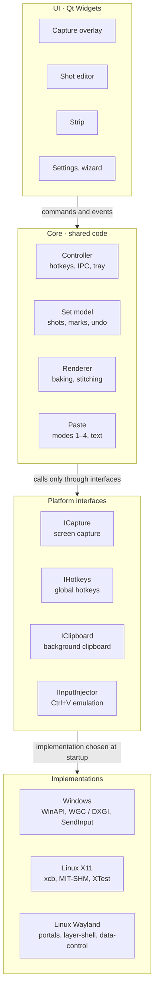

# Spec: a Snapik alternative for Windows and Linux

Oct 19, 2026 · @Andrew

> Translated from the Russian original (2026-10-21; the original is in the git history). The working name **Pointshot** is kept as written: the program is called Markpaste (ADR 0005). Where the implementation differs from this spec, see [docs/deviations.md](docs/deviations.md).

## 1. Analysis of the original: what Snapik can do

Snapik 1.9 is a utility for Windows 10/11 and macOS 14+. It takes several screenshots, puts numbered marks with comments on them and pastes everything into any chat with one Ctrl+V. The price is €19 once, the first 7 days are free. There is no Linux version. Below is everything visible on the website, in the terms, the privacy policy and the GitHub releases.

### Features

| Feature | How it works in Snapik | Source |
| --- | --- | --- |
| Capture | Print Screen (Windows) or ⌥⌘S (Mac), the key can be reassigned. The screen "freezes", the user outlines the needed area | [website](https://getsnapik.com/ru) |
| Marks | An outlined button or block gets a mark A1, A2…: the letter is the shot number, the digit is the place on it. A comment field opens right next to it | [website](https://getsnapik.com/ru) |
| Shot strip | Shots pile up in a small strip at the side of the screen, up to 26 (A–Z). Each one shows the number of comments, there is a "New shot" button | [website](https://getsnapik.com/ru) |
| Paste | One Ctrl+V / ⌘V pastes all shots into the chat at once, with text below them: "Shot A", "A1 …", "A2 …", "Shot B"… | [website](https://getsnapik.com/ru) |
| Where to paste | ChatGPT, Codex, Claude, Cursor, Telegram, WhatsApp: any chat that accepts images. Snapik sends nothing itself | [website](https://getsnapik.com/ru) |
| Blur | Swipe over a password or a card number, and a blurred version goes to the chat | [website](https://getsnapik.com/ru) |
| Crop and undo | Cropping a shot, Ctrl+Z undoes any number of steps (a wrong frame, blur, crop) | [website](https://getsnapik.com/ru) |
| Privacy | Shots, notes and settings are stored locally. Only anonymous events (install, end of trial, activation) with the program and OS version go out; can be turned off in settings | [privacy](https://getsnapik.com/privacy) |
| License | The key arrives by e-mail after paying through Lemon Squeezy and is checked with them on activation. One purchase covers two computers | [terms](https://getsnapik.com/terms) |
| Updates | Windows updates itself from GitHub, there are `win` and `beta` channels. The Mac version does not update itself yet | [download](https://getsnapik.com/download) |

### What the builds show

The conclusions below are drawn from the files of release [1.9.8](https://github.com/getsnapik/releases/releases/tag/1.9.8) and the download page; Snapik has no sources.

- **The Windows installer is built with Velopack.** This is indicated by `SnapikApp-win-Setup.exe`, `*-full.nupkg`, `releases.win.json` and the `beta` channel. Velopack is most often used with .NET, and the installer is about 90 MB, which looks like a self-contained .NET application.
- **The Mac version is a separate program** in a separate repository `releases-mac`, without auto-update. Most likely a native application rather than shared cross-platform code.
- **Pasting emulates key presses.** On Mac pasting with ⌘V needs the "Accessibility" permission. It is required for synthesizing keyboard events. So Snapik probably puts the items into the clipboard one by one and presses "paste" itself for each.
- **Frequent releases:** 1.9.0 came out on September 29, 2026, 1.9.8 on October 14, 2026.
- **No code signing.** Windows shows a SmartScreen warning, macOS requires a manual permission to run.

## 2. Project goal and scope

The goal is an open source desktop program for Windows 10/11 and Linux (X11 and Wayland) with the same scenario as Snapik: capture, mark, annotate, paste into a chat in one action. The working name in this document is **Pointshot** (provisional, may change).

**Linux: the focus is Wayland.** The main Linux target is a Wayland session. In Fedora since version 43 GNOME runs only on Wayland ([Linuxiac](https://linuxiac.com/fedora-43-drops-gnome-x11-support/)), and KDE is on Wayland by default too. The reference system for development and acceptance is **Fedora 44** (GNOME 50 and KDE Plasma 6.6, [released on April 28, 2026](https://linuxiac.com/fedora-44-officially-released-this-is-whats-new/)). Every feature is first built and checked on Wayland. X11 is supported, but without a guarantee of equal capabilities and without priority in bug fixing.

**The main success criterion:** a user goes from pressing the key to a ready message in ChatGPT or Telegram with three shots and five comments in less than 60 seconds, without opening separate editor windows.

### In the MVP (version 1.0)

- Capturing a screen area with a global hotkey the user assigns (Print Screen by default). Support for several monitors with different scales.
- Rectangular marks with automatic numbering A1, A2… and a comment field for each.
- A strip of up to 26 shots (A–Z) with switching between them, deleting and retaking.
- Blur (pixelation) of an area, cropping a shot, multi-step undo and redo.
- Pasting the whole set into the active chat: sequential paste (the main mode) and fallback modes: a file list, drag and drop, stitching into one image.
- A tray icon where there is a tray, settings, autostart, Russian and English UI.
- Packages: Windows (Setup.exe with auto-update and a portable ZIP), Linux (.deb and .rpm).
- Open source code in a public repository, license GPL-3.0-or-later (section 11).

### Second round (1.x)

- Other mark shapes: arrow, point marker, freehand line.
- Message text templates (for example, an opening phrase for an AI: "Fix point by point…").
- Saving the set to a folder (PNG + Markdown) and a history of recent sets.
- AppImage and Flatpak packages, publishing on Flathub.
- A macOS version. It is not in 1.0, but the architecture plans for it from day one (sections 8 and 9).

### Out of scope

- Video and GIF recording, OCR, cloud storage and links to shots.
- Sending messages on the user's behalf: the program only prepares the paste, a person presses "Send".
- A paid version, a trial period and activation keys: the project is distributed free with open source code.

## 3. Terms

| Term | Meaning |
| --- | --- |
| Shot | A cropped image of part of the screen. Denoted by a letter A–Z in the order of creation |
| Mark | A marked area on a shot with a number and a comment. The identifier is the shot letter + a sequence number: A1, A2, B1 |
| Comment | Text attached to a mark. May be empty, then only the number goes into the message |
| Set | All shots of the strip with marks and comments. This is what is pasted into the chat |
| Strip | A compact panel at the screen edge with the list of the set's shots |
| Overlay | A full-screen window over a "frozen" screenshot in which the area of the future shot is selected. Marks are placed later, in the editing window |
| Baking (render) | Applying marks and blur to the shot's pixels before pasting. The source shot does not change |
| Sequential paste | A mode in which the program puts each item of the set into the clipboard in turn and presses Ctrl+V itself |
| Portal | xdg-desktop-portal, the standard Linux D-Bus interface through which applications on Wayland get screenshots, global hotkeys and input |

## 4. The main scenario

The scenario goes straight; there is a branch only at step 6.

1. The user presses the hotkey (set in settings, Print Screen by default; Linux specifics are in section 9).
2. The program captures all monitors and shows an overlay with the frozen, slightly dimmed picture. The cursor is a crosshair, with a magnifier and coordinates next to it.
3. The user outlines an area. It becomes shot **A**, the overlay closes, and the shot editing window appears with the strip: at the screen edge where a window can be placed, and on GNOME where the system puts it.
4. In the editing window the user outlines a button: mark **A1** appears with a focused comment field. They write "Make the button brighter", Enter fixes the comment. A2 is placed the same way, data is blurred or the shot is cropped if needed.
5. If another screen is needed: the hotkey or "New shot" in the strip. Steps 2–4 repeat, the shot gets the letter **B**.
6. The user switches to the chat and presses the global paste-set key. On Windows and X11 the ordinary Ctrl+V or the "Paste" button in the strip can also be used.
   - **Sequential paste is available** (Windows, X11 and Wayland where the program can change the clipboard from the background and got the portal permission): the program pastes all shots and then the text.
   - **Not available**: the program offers a fallback mode: drag the set from the strip into the chat or paste a stitched image with the text.
7. The message is assembled in the input field. The user adds text if they like and presses "Send" themselves.
8. The strip offers "Clear set", or clears itself on the next capture if so set in settings.

## 5. Functional requirements

Priority: **M**, required for 1.0; **S**, desirable for 1.0; **C**, second round.

### 5.1 Capture

| ID | Requirement | Priority |
| --- | --- | --- |
| CAP-1 | A global hotkey starts a capture from any application while the program runs in the background. The key or shortcut is set in settings, Print Screen by default. If it is taken by the system or another program, the application reports it and suggests choosing another | M |
| CAP-2 | The contents of all monitors at the moment of the press are captured. The overlay appears no later than 300 ms | M |
| CAP-3 | Selecting an area with the mouse: a frame, size in pixels, a ×4 magnifier at the cursor, moving and resizing the frame before confirmation | M |
| CAP-4 | Confirmation is releasing the mouse (quick mode) or Enter (precise mode), set in settings. Esc cancels the capture | M |
| CAP-5 | Highlighting the window under the cursor and capturing a window with one click (Windows and X11 only) | S |
| CAP-6 | Capture on monitors with different scales (100–200 %) without blur: the shot is stored in physical pixels | M |
| CAP-7 | Starting a capture from the command line `pointshot --capture` in an already running instance (needed for Wayland environments without a hotkeys portal) | M |
| CAP-8 | If the strip already has 26 shots, the capture does not start, and the strip highlights the message "The set is full" | M |

### 5.2 Marks and shot editing

| ID | Requirement | Priority |
| --- | --- | --- |
| EDT-1 | A rectangular mark is drawn by dragging the mouse. Right after it a focused comment field appears | M |
| EDT-2 | Numbering is automatic: A1, A2… When a mark is deleted, the other numbers are recomputed without gaps | M |
| EDT-3 | The number badge is a circle of the accent color with a white digit at the top-left corner of the frame, not going beyond the shot edge | M |
| EDT-4 | A mark can be moved, resized, deleted (Delete), and its comment edited with a double click | M |
| EDT-5 | A comment is one or several lines up to 500 characters. Enter saves, Shift+Enter inserts a line break | M |
| EDT-6 | Blur: a rectangle is selected by dragging, inside it pixelation with a 12 px block. Source pixels do not get into the output image | M |
| EDT-7 | Cropping a shot keeping the marks. Marks that end up outside the area are deleted after confirmation | M |
| EDT-8 | Undo and redo (Ctrl+Z / Ctrl+Shift+Z) without a depth limit within the set, including deleting a shot | M |
| EDT-9 | Arrow and point marker as alternative mark shapes | C |
| EDT-10 | Comment captions right on the image (the "text on image" option) | C |

### 5.3 Strip

| ID | Requirement | Priority |
| --- | --- | --- |
| STR-1 | A floating panel at the screen edge above windows: shot thumbnails with a letter and the number of comments. In GNOME "above windows" and choosing the position are unavailable, so there the strip is an ordinary window (section 9) | M |
| STR-2 | Buttons "New shot", "Paste set", "Clear". A counter "3 shots · 4 comments" | M |
| STR-3 | A click on a thumbnail opens the shot for editing. Dragging changes the order, letters are recomputed | S |
| STR-4 | Deleting a shot with the letters of the following shots and all marks recomputed | M |
| STR-5 | The strip can be collapsed to an icon and dragged to another edge, the position is remembered. Windows, X11 and compositors with layer-shell only | S |
| STR-6 | Dragging the set or a single shot from the strip into another application as files (drag and drop) | M |

### 5.4 Pasting the set

| ID | Requirement | Priority |
| --- | --- | --- |
| PST-1 | The "sequential paste" mode: images A, B, C… one by one, then the text. Details in section 10 | M |
| PST-2 | Starting a paste: the global paste-set key (everywhere), intercepting the ordinary Ctrl+V with a non-empty set and the option on (Windows and X11 only), a button in the strip (mode 1 on Windows and X11 only, on Wayland the button copies the set in mode 2). The default key must not be Ctrl+Shift+V: that is paste in terminals and "paste as text" in browsers, where images are lost. The candidate is Ctrl+Alt+V, chosen on the prototype | M |
| PST-3 | The message text is built from a template. By default "Shot A", then lines "A1 comment", an empty line between shots | M |
| PST-4 | The "files + text" mode: a list of PNG files and the text are put into the clipboard at once, pasted with one native Ctrl+V | M |
| PST-5 | The "stitch" mode: all shots are assembled into one vertical image with captions A, B, C; the text goes as the second item | M |
| PST-6 | A preview of what goes to the chat: the baked images and the final text | S |
| PST-7 | Compression: PNG by default, JPEG 85 % when larger than 5 MB, the long side limited to 4096 px (configurable) | S |
| PST-8 | After a paste the original clipboard content is restored | S |
| PST-9 | The program never presses Enter by itself and never sends the message | M |

### 5.5 Application and settings

| ID | Requirement | Priority |
| --- | --- | --- |
| APP-1 | Running in the background with a tray icon: "Capture", "Show strip", "Settings", "Quit". In GNOME (Fedora Workstation) there is no tray without extensions, so the program is fully usable without it: a repeated start from the application menu opens the strip and settings, capture and paste go through global hotkeys | M |
| APP-2 | A single instance only. A repeated start passes its command to the running instance | M |
| APP-3 | Settings: hotkeys, paste mode, text template, mark accent color, image format, autostart, language, auto-clear | M |
| APP-4 | A first-start wizard: checking capture, hotkeys and paste on the current system, hints for Wayland | M |
| APP-5 | The UI in Russian and English, chosen by the system language | M |
| APP-6 | Saving the set to a folder: PNG files and `message.md` | C |
| APP-7 | Automatic installation of updates on Windows. On Linux, a notification about a new version, updating through the package manager | S |

## 6. Non-functional requirements

| ID | Area | Requirement |
| --- | --- | --- |
| NFR-1 | Speed | From the hotkey to the overlay no more than 300 ms on 2 4K monitors on Windows and X11, no more than 800 ms on Wayland: there the capture goes through a portal, the number is refined on the prototype. Pasting a set of 5 shots takes no more than 3 s |
| NFR-2 | Resources | In the background: up to 60 MB RAM and 0 % CPU. With a full set of 26 4K shots, up to 600 MB. For this the sources are stored compressed (PNG in memory), and only the shot open in the editor is kept uncompressed: 26 uncompressed 4K frames take about 860 MB |
| NFR-3 | Size | The Windows installer up to 40 MB. The .deb and .rpm packages without a bundled Qt up to 5 MB |
| NFR-4 | Privacy | Shots and comments do not leave the computer except when the user pastes them. There is no telemetry. Shots do not get into the clipboard history and cloud clipboard sync (section 10). The only network request is the new version check against GitHub Releases, which can be turned off in settings |
| NFR-5 | Storage | The set is kept in memory. With the "survive a restart" option on, in the user data directory with mode 0700 (Linux) or in %LOCALAPPDATA% (Windows) |
| NFR-6 | Platforms | Windows 10 22H2 and Windows 11 x64. Linux x86_64. The reference is Fedora 44 on Wayland (.rpm): GNOME 50, KDE Plasma 6.6, Sway Spin. In addition: .deb for Ubuntu 24.04+ and Debian 12+, .rpm for openSUSE Tumbleweed. X11 without a guarantee of equal capabilities |
| NFR-7 | Quality | Lossless shots (PNG), irreversible blur, mark coordinates in physical pixels |
| NFR-8 | Reliability | A capture or paste failure does not crash the program, the user sees a clear message and a fallback |
| NFR-9 | Accessibility | All actions are reachable from the keyboard. The contrast of mark badges is at least 4.5:1 |
| NFR-10 | Localization | All strings are in external translation files. The message text template is localized separately from the UI |
| NFR-11 | Portability | No OS-specific code in the core and the UI: no `#ifdef _WIN32` outside the `platform/` directory. Paths go through `QStandardPaths`, keys through the "primary modifier" abstraction (Ctrl on Windows and Linux, ⌘ on macOS). Adding macOS needs no core changes |
| NFR-12 | Openness | Building from source with one CMake command on a clean system. All dependencies are free and available in the repositories of the target distributions |

## 7. Stack

**Decision: C++20 + Qt 6 (Widgets and QPainter), a CMake build, a thin platform layer on WinAPI, xcb and D-Bus portals.** All logic, the editor, the strip and rendering are shared code. Platform code is limited to four interfaces: capture, global hotkeys, clipboard, input emulation.

### Why Qt

- **Wayland without XWayland.** Qt has a mature native Wayland client, and that is the project's main difficulty: a full-screen overlay, the clipboard, monitor scaling.
- **A clipboard with several formats at once.** `QMimeData` puts `image/png`, `text/uri-list` (CF_HDROP on Windows), `text/html` and `text/plain` into one entry. This is needed for the "files + text" mode.
- **Painting.** QPainter gives antialiased frames, badges, pixelation and fast output of 4K images without a WebView.
- **D-Bus out of the box.** QtDBus allows calling the Screenshot, GlobalShortcuts and RemoteDesktop portals without extra dependencies.
- **Size.** An installer with the needed modules (Core, Gui, Widgets, DBus, WaylandClient) fits into 25–40 MB, less than the original's ~90 MB.
- **License.** Qt under LGPLv3 is compatible with the project's open GPL-3.0-or-later license, and Qt itself is already in the repositories of all target distributions.

The Qt versions differ for the two platforms. On Windows Qt is shipped with the program, a fresh 6.10 or newer is used (as of October 2026 6.12 is current, [Qt Releases](https://doc.qt.io/qt-6/qt-releases.html)). On Linux the .deb and .rpm packages use the system Qt, so the minimum version is 6.4: that is what Ubuntu 24.04 ([qt6-base-dev 6.4.2](https://packages.ubuntu.com/noble/qt6-base-dev)) and Debian 12 have. The code must not use API newer than Qt 6.4; this is checked by a CI build on Ubuntu 24.04.

### Options considered

| Stack | Pros | Cons | Verdict |
| --- | --- | --- | --- |
| **C++20 + Qt 6** | Native Wayland, full control over the clipboard and windows, small size | Needs an experienced C++/Qt developer, the UI takes longer to write | **Chosen** |
| .NET 9 + Avalonia | Most likely close to the original (Velopack, ~90 MB). Fast development in C# | Less mature Wayland support, portals and xcb through P/Invoke and third-party libraries, larger size | A fallback if the team is on C# |
| Rust + Tauri 2 | Small size, a safe language, ready crates for capture and the clipboard | The UI is WebKitGTK on Linux: a transparent full-screen overlay and many windows are unstable, a multi-format clipboard is on your own | Not chosen |
| Electron | The fastest UI with web technologies | 100+ MB, high memory use, the same Wayland problems, violates NFR-2 and NFR-3 | Not chosen |
| Flutter Desktop | A nice UI | Weak support for multiple windows and overlays, little ready-made for the clipboard and portals | Not chosen |

### Stack components

| Layer | Technology |
| --- | --- |
| Language and build | C++20, CMake 3.28+, Ninja. On Linux only system packages, on Windows Qt via aqtinstall, the rest via vcpkg |
| UI | Qt Widgets + QPainter: overlay, editor, strip, settings |
| Windows | WinAPI: `RegisterHotKey`, `SetWindowsHookEx(WH_KEYBOARD_LL)`, `SendInput`, capture through Qt / GDI `BitBlt` or DXGI Desktop Duplication |
| Linux X11 | xcb + xcb-xtest: `XGrabKey`, Ctrl+V emulation, capture through `xcb_get_image` / MIT-SHM |
| Linux Wayland | QtDBus → xdg-desktop-portal: Screenshot, ScreenCast (a fast capture option), GlobalShortcuts, RemoteDesktop, Clipboard, FileTransfer. The `ext-data-control-v1` / `wlr-data-control` and `virtual-keyboard-v1` protocols through a separate libwayland-client connection and wayland-scanner, as in wl-clipboard. Layer-shell for Qt windows through LayerShellQt for Qt 6: it is in Fedora 44 together with Plasma 6.6. The dependency is optional: without it the overlay and the strip work as ordinary windows. We do not write our own layer-shell implementation on Qt windows: the surface role is assigned by the Qt shell plugin through private API |
| macOS (groundwork) | A `platform/macos/` directory with interface stubs, the CMake target is built in CI but not released (section 9) |
| Images | QImage (PNG, JPEG), our own pixelation |
| Settings | QSettings (INI) in the user's configuration directory |
| Logs | spdlog with rotation, without shot contents |
| Tests | GoogleTest for the model and rendering, Qt Test for the UI, reference PNGs for baking |
| Packages | Windows: Velopack (Setup.exe with auto-update, a portable ZIP). Linux: CPack (.deb and .rpm) |
| CI | GitHub Actions: windows-2022, ubuntu-24.04, fedora (container), macos (build only). Publishing to GitHub Releases |

## 8. Architecture

The program is one process with four layers. The UI and the core do not know which system they run on: everything platform-specific is hidden behind four interfaces, and the right implementation is chosen at startup.



The core talks to the platform only through ICapture, IHotkeys, IClipboard and IInputInjector. A new platform (for example, macOS) can be added without touching the UI and the core.

### Modules

| Module | Responsible for | Key classes |
| --- | --- | --- |
| Controller | Startup, single instance (QLocalServer), tray, commands from hotkeys and the CLI | `AppController`, `SingleInstance`, `TrayMenu` |
| Set model | Shots, marks, comments, numbering, undo history on `QUndoStack` | `CaptureSet`, `Shot`, `Mark`, `Redaction` |
| Overlay | The frozen screen on each monitor, area selection, magnifier | `CaptureOverlay`, `ScreenFrame` |
| Editor | Drawing marks, the comment field, blur, crop | `ShotEditor`, `MarkItem`, `CommentPopup` |
| Strip | Thumbnails, reordering, dragging outside, starting a paste | `StripWindow`, `ShotThumb` |
| Renderer | Baking marks and blur, stitching, compression | `ShotRenderer`, `Composer`, `ImageEncoder` |
| Paste | Text template, modes 1–4, delay profiles, clipboard restore | `MessageBuilder`, `PasteOrchestrator`, `AppProfiles` |
| Platform | Implementations of the four interfaces, environment detection | `PlatformFactory`, `WinCapture`, `X11Hotkeys`, `PortalScreenshot`, `WlDataControlClipboard` |

### Data model

```cpp
struct Mark {
    QUuid id;
    QRect rect;            // in physical pixels of the source
    QString comment;       // up to 500 characters
};                         // number = position in Shot::marks + 1

struct Redaction {
    QRect rect;            // pixelation area
};

struct Shot {
    QUuid id;
    QByteArray sourcePng;  // source without marks, compressed (NFR-2)
    QSize sourceSize;
    qreal devicePixelRatio;
    QRect crop;            // crop without losing the source, for undo
    QList<Mark> marks;
    QList<Redaction> redactions;
};                         // letter = position in CaptureSet::shots

struct CaptureSet {
    QList<Shot> shots;     // no more than 26
};
```

The mark number and the shot letter are not stored but computed from the position in the list. This way reordering, deleting and undo cannot leave numbers out of sync. The crop does not change the source but is kept as a rectangle: it can be undone without a copy of the frame.

### Threads

- The UI, the model and platform calls are in the Qt main thread. Answers are awaited asynchronously, through `QFuture` and signals, without blocking and nested event loops.
- Heavy work (decoding a frame from the portal, cutting it by monitors, baking, PNG encoding) is in the `QtConcurrent` thread pool. `QScreen::grabWindow` is called only from the main thread, as Qt requires.
- Sequential paste is a state machine on `QTimer` in the main thread.
- The libwayland-client connection for data-control and virtual-keyboard is served through a `QSocketNotifier` in the main thread.

### Platform interfaces

All four interfaces are asynchronous: on Wayland a portal dialog may stand behind a call, and the answer comes after seconds or never. The core chooses the paste mode by the declared capabilities (`capabilities()`), not by the OS name, so a new platform or a new compositor does not need core changes.

```cpp
class ICapture : public QObject {
    Q_OBJECT
public:
    virtual QFuture<CaptureResult> captureAllScreens() = 0; // frame + monitor geometry and scale
    virtual CaptureCaps capabilities() const = 0;            // window under the cursor, etc.
};

class IHotkeys : public QObject {
    Q_OBJECT
public:
    // The actual shortcut may differ: on Wayland the user confirms it
    virtual QFuture<BindResult> bind(Action action, const QKeySequence &preferred) = 0;
signals:
    void activated(Action action, const ActivationContext &ctx); // activation token, if any
    void released(Action action);                                 // the key was released
};

class IClipboard : public QObject {
    Q_OBJECT
public:
    virtual bool canWriteInBackground() const = 0;
    virtual QFuture<void> write(const ClipboardPayload &data, ClipboardFlags flags) = 0; // flags: not into history, not into the cloud
    virtual QFuture<ClipboardPayload> snapshot() = 0;  // for restoring after a paste
};

class IInputInjector : public QObject {
    Q_OBJECT
public:
    virtual QFuture<void> waitModifiersReleased(std::chrono::milliseconds timeout) = 0;
    virtual QFuture<void> sendPaste() = 0;              // by the V key code, not by the character
    virtual bool canDetectForegroundChange() const = 0; // false on Wayland
};
```

## 9. Platform specifics

Windows and Linux X11 give everything needed directly. On Wayland each capability goes through a portal or a compositor protocol, and on GNOME some of them are unavailable. So at startup the program detects the environment (`XDG_SESSION_TYPE`, `XDG_CURRENT_DESKTOP`, the list of Wayland globals, portal versions) and enables the available mechanisms.

### Priority: Wayland on Fedora 44

The reference environments are three Fedora 44 editions, all on Wayland. The hardest of them is Workstation with GNOME: it is the default Fedora edition, and it has the fewest capabilities for background pasting.

| Fedora 44 edition | Compositor | Background clipboard | Expected paste mode |
| --- | --- | --- | --- |
| Workstation | GNOME 50 (Mutter) | No `ext-data-control-v1` ([wayland.app](https://wayland.app/protocols/ext-data-control-v1)). Check the Clipboard portal | Modes 2–4. Mode 1 if the Clipboard portal is confirmed |
| KDE Plasma Desktop | Plasma 6.6 (KWin) | `ext-data-control-v1` is declared for the current KWin. Check on 6.6 | Mode 1, fallbacks 2–4 |
| Sway Spin | Sway | `ext-data-control-v1` | Mode 1, the key through the Sway config |

Requirements for the Wayland version:

- **Native Wayland only.** In a Wayland session the program runs on Qt's `wayland` platform, not through XWayland. Global hotkeys and capturing other windows do not work under XWayland, so in such a launch the program shows a warning.
- **The application ID.** Portals identify programs outside Flatpak by the systemd unit name (`app-<id>-….scope`) or by explicit registration through `org.freedesktop.host.portal.Registry` ([details](https://blogs.gnome.org/ignapk/?p=69)). Without an ID portals cannot tie granted permissions and restore tokens to the program. So the program registers with the very first portal call, and the ID matches the .desktop file name (section 11).
- **The Clipboard portal is a hypothesis for GNOME.** The `org.freedesktop.portal.Clipboard` portal gives a RemoteDesktop session access to the clipboard: the program declares MIME types and serves data on request without focus ([documentation](https://flatpak.github.io/xdg-desktop-portal/docs/doc-org.freedesktop.portal.Clipboard.html)). Access is requested before the session starts. If the GNOME 50 backend supports it, sequential paste will work in Workstation too. This is checked in the first week of the prototype.
- **Overlay focus on GNOME.** A window opened by a global hotkey may not be activated by GNOME because of focus stealing prevention. Then the mouse works, but Esc and Enter do not. If the GlobalShortcuts portal passes an xdg-activation token, the program uses it. The behavior is checked on the prototype.
- **Capture speed.** The Screenshot portal returns a PNG of the whole screen through a file; on 2×4K that takes hundreds of milliseconds. The prototype compares speedups: a ScreenCast portal session (PipeWire) and, on KDE, the KWin ScreenShot2 interface for programs declared trusted in the .desktop file.
- **The RemoteDesktop session only for the duration of a paste.** While the session is open, GNOME shows a remote control indicator. So it is opened by the restore token before a paste and closed right after, not kept open all the time.
- **Fallback modes are full-fledged, not emergency ones.** On GNOME the "files + text" mode and dragging from the strip must be convenient by default: a large "Copy set" button in the strip, the hint "now press Ctrl+V in the chat".
- **One wizard window for all permissions.** Screenshot, the global hotkey and RemoteDesktop are requested one after another on the first start, and the restore tokens are saved so that the dialogs do not repeat.
- **Scale.** Wayland fractional scaling (125 %, 150 %, 175 %) and monitors with different scales are mandatory scenarios; mark coordinates are computed in physical pixels of the shot. Qt 6.4 (Ubuntu 24.04, Debian 12) does not support the fractional scale protocol, it appeared around Qt 6.5. There the program UI may be blurry; Fedora 44 does not have this problem.

### Capability matrix

| Capability | Windows 10/11 | Linux X11 | Wayland: KDE Plasma 6 | Wayland: GNOME | Wayland: Sway, Hyprland |
| --- | --- | --- | --- | --- | --- |
| Screen capture | Windows.Graphics.Capture or DXGI, GDI as a fallback | xcb, no permissions | The Screenshot portal. Faster: KWin ScreenShot2 for trusted programs | The Screenshot portal (a permission request the first time) or a ScreenCast session | The Screenshot portal (-wlr / -hyprland) or `ext-image-copy-capture` |
| Global hotkey | `RegisterHotKey`, for Print Screen the `WH_KEYBOARD_LL` hook | `XGrabKey` | The GlobalShortcuts portal | The GlobalShortcuts portal since GNOME 48 ([TWIG #189](https://thisweek.gnome.org/posts/2025/02/twig-189)). In GNOME 46–47 (Ubuntu 24.04), a custom shortcut in the GNOME settings for `pointshot --capture` | Hyprland: the portal. Sway: a binding in the config to `pointshot --capture` |
| Overlay above everything | A frameless topmost window | A `_NET_WM_STATE_FULLSCREEN` + above window | Layer-shell (LayerShellQt) | A full-screen window on each monitor | Layer-shell if built with LayerShellQt, otherwise full-screen windows |
| Overlay focus after the key | Yes | Yes | Yes | Not guaranteed (focus stealing prevention). An activation token is needed, to be checked | Yes |
| Strip above windows | A topmost window | A window with the "above" flag | Layer-shell | **Impossible** for an ordinary window. The strip is an ordinary small window | Layer-shell |
| Tray icon | Yes | Yes | Yes | **No** without the AppIndicator extension | Depends on the bar (swaybar, waybar: yes) |
| Changing the clipboard from the background | Yes | Yes | `ext-data-control-v1` (check on 6.6) or the Clipboard portal | **No** data-control. The Clipboard portal, to be checked | `ext-data-control-v1` / `wlr-data-control` |
| Ctrl+V emulation | `SendInput` | XTest | The RemoteDesktop portal | The RemoteDesktop portal | `virtual-keyboard-v1` |
| Intercepting the ordinary Ctrl+V | The `WH_KEYBOARD_LL` hook | `XGrabKey` while a set is active | No, a separate paste key | No, a separate paste key | No, a separate paste key |
| Active window (delay profiles, window change control) | Yes | Yes | No | No | No |
| Sequential paste | Yes | Yes | Yes | Only if the Clipboard portal is confirmed, otherwise modes 2–4 | Yes |

### Windows

- **Print Screen.** In Windows 11 the key opens the Snipping Tool by default, and `RegisterHotKey` will not get it. A `WH_KEYBOARD_LL` hook that swallows the press is needed. The first-start wizard suggests turning off the "Use the Print Screen key to open Snipping Tool" setting.
- **Scale.** The process runs in Per-Monitor DPI Aware v2 mode (the Qt 6 default). Overlay coordinates are computed in physical pixels of each monitor.
- **Capture.** The main path is Windows.Graphics.Capture: it captures HDR monitors correctly, while GDI `BitBlt` gives a washed-out picture on them. On Windows 10 this API draws a yellow border around the capture, which can be turned off only on Windows 11, so there the main path is DXGI Desktop Duplication.
- **Own key presses.** The `WH_KEYBOARD_LL` hook sees emulated events too. Presses with the `LLKHF_INJECTED` flag are skipped, otherwise the program would intercept its own Ctrl+V. The hook is installed only while needed, writes nothing to the log and answers instantly: Windows silently disables a slow hook.
- **Clipboard history.** Entries with images are marked with the `ExcludeClipboardContentFromMonitorProcessing`, `CanIncludeInClipboardHistory = 0` and `CanUploadToCloudClipboard = 0` formats. Otherwise the shots get into the Win+V history and cloud clipboard sync.
- **Elevated rights.** `SendInput` cannot paste into windows started as administrator (UIPI). In that case the program shows a hint and switches to the "files + text" mode.
- **SmartScreen.** The installer is signed through the SignPath Foundation (section 11), otherwise Windows shows a warning, as with the original.

### Linux X11

- Capturing the whole root window through MIT-SHM, then cutting it by monitors from XRandR.
- The Print Screen key is often taken by the desktop (GNOME, KDE on X11). The capture key is a configurable setting: the wizard checks whether it is free and suggests choosing another one or turning off the system one.
- On X11 the clipboard lives while the owner process lives. The program stays the owner until the set is cleared.

* **Own key presses.** Before emulating Ctrl+V through XTest the key grab (`XGrabKey`) is released, otherwise the program would intercept its own press. After the paste the grab comes back.

### Linux Wayland

- **Capture.** The Screenshot portal with `interactive=false` returns a file with the whole screen. The program reads it, deletes it right away and shows its own overlay on top.
- **Overlay on GNOME.** Without layer-shell the overlay is a full-screen window on each monitor. The program cannot turn off GNOME's window appearance animation, so the overlay may open with a short animation over the live screen. How noticeable this is gets checked on the prototype.
- **The RemoteDesktop portal.** Requested for the keyboard only, with `persist_mode=2`, so that the permission dialog appears once. The restore token is kept in settings.
- **Without portals.** On minimal environments without xdg-desktop-portal the program reports what is missing and suggests CLI commands for binding keys.
- **Flatpak.** Not released in 1.0. When it appears, only portals will work in the sandbox, and data-control and virtual-keyboard will have to be disabled. The full set of capabilities is in the .deb and .rpm packages.

* **A key through the portal.** On GNOME and KDE the program suggests the shortcut from settings to the GlobalShortcuts portal, and the user confirms it for good and may change it in the system dialog. The program settings show the actually assigned shortcut.

### macOS: groundwork, not in 1.0

A macOS version may be needed later, so its path is laid now. The core and the UI do not change, only a `platform/macos/` directory with four implementations is added.

| Interface | macOS API | Specifics |
| --- | --- | --- |
| ICapture | ScreenCaptureKit (`SCScreenshotManager`) | The "Screen Recording" permission on the first capture |
| IHotkeys | Carbon `RegisterEventHotKey` | Needs no permissions |
| IClipboard | `NSPasteboard` | The clipboard can be written from the background, no restrictions as on GNOME |
| IInputInjector | `CGEventPost` (⌘V) | The "Accessibility" permission, as for the original Snapik |

What is done already in 1.0 so that the port takes weeks rather than months:

- A CMake target for macOS is built in CI with interface stubs. The build must not break.
- The paste modifier and shortcuts are stored in settings in a portable form (`Primary+Shift+V`), not as Ctrl.
- The first-start wizard can show the steps of granting system permissions: two of them on macOS, portals on Wayland.
- Icons, translations and the message template are not tied to the platform.

A release will need a .dmg via macdeployqt, Apple signing and notarization (a paid developer account, $99 a year); this is decided separately.

## 10. Pasting the set and the clipboard

The clipboard cannot hold "several images and text" so that any chat pastes them with one Ctrl+V. So the main mode is sequential paste: the program itself puts the items into the clipboard one at a time and presses Ctrl+V for the user. The other modes are fallbacks.

### Message text

The default template (Russian locale). Empty comments give a line with just the number, shots without marks give just a header.

```markdown
Снимок A
A1 Кнопку «Купить» ярче
A2 Цену на карточках крупнее

Снимок B
B1 Убрать этот блок
```

(In English: "Shot A / A1 Make the 'Buy' button brighter / A2 Larger prices on the cards / Shot B / B1 Remove this block".)

Configurable: the shot header, the mark line format (`{id} {text}`, `{id}: {text}`, `**{id}** {text}`), an opening and a closing phrase, and the text position: after the images or before them.

### Mode 1. Sequential paste (the main one)

1. The user starts the paste: Ctrl+V with an active set (Windows, X11), a separate key or the button in the strip. The strip button starts mode 1 only on Windows and X11: there the program can return focus to the window that was active before. On Wayland focus cannot be returned to someone else's window, so mode 1 is started only by the global key from the chat window, and the button copies the set in mode 2.
2. The program saves the current clipboard content.
3. For each shot in order: bake the marks and blur, put the PNG into the clipboard, wait 80 ms, emulate Ctrl+V, wait the profile delay (400 ms by default).
4. Put the message text into the clipboard and emulate Ctrl+V.
5. After 1 s, restore the original clipboard content.
6. During the paste an indicator "Pasting 2 of 4" is visible over the strip, Esc interrupts the process. If the active window changed, the paste stops (on Windows and X11; on Wayland a window change cannot be tracked).

Input emulation rules:

- **Released modifiers.** Before the first Ctrl+V the program waits until the user releases the shortcut keys (the `released` signal, on Wayland the GlobalShortcuts portal's `Deactivated`), plus 50 ms. Otherwise a held Shift or Alt turns the emulated Ctrl+V into another shortcut.
- **The key code, not the character.** V is pressed by the key code: `VK_V` on Windows, keycode 55 on X11, `KEY_V` in evdev for the portals. With a Russian layout there is no "v" character, and emulating by character would fail or switch the layout.
- **The virtual keyboard layout.** `virtual-keyboard-v1` requires passing a keymap to the compositor. The standard `us` is passed for the virtual device only; side effects on the user's layout are checked on Sway.
- **Own events.** The Ctrl+V interceptors on Windows and X11 skip presses emulated by the program itself (section 9).

The delays come from the application profile determined by the active window (the process name on Windows, `WM_CLASS` on X11). On Wayland the active window cannot be found out, so a common profile is used.

| Profile | Delay between images | Specifics |
| --- | --- | --- |
| Default | 400 ms | — |
| Browsers (ChatGPT, Claude) | 600 ms | Image upload is asynchronous, too fast a paste loses items |
| Telegram Desktop | 300 ms | The first image is expected to open the send window, the next ones are added to an album, and the text goes into the caption. Checked on the prototype |
| Cursor, VS Code | 400 ms | — |

The delay values are starting ones and are refined on the prototype (section 12).

### Mode 2. Files + text

One clipboard entry with several formats at once. The program writes the PNGs into a temporary folder and puts:

- `text/uri-list` (CF_HDROP on Windows): the list of files;
- `x-special/gnome-copied-files`: for GNOME file managers;
- `text/plain`: the message text;
- `image/png`: the first shot, for applications that accept only one image.

This works with one native Ctrl+V, but each application picks its own format from the entry. Some programs take the files and ignore the text, others the opposite. The mode is used on GNOME Wayland and on input emulation errors. The temporary files are deleted when the set is cleared and on exit.

**Sandboxed programs.** Telegram Desktop from Flathub and browsers in Snap or Flatpak do not see the files in the program's temporary folder, so the file list from modes 2 and 3 will not paste into them. The files are additionally passed through the FileTransfer portal: the program registers them in the portal and puts the `application/vnd.portal.filetransfer` key into the entry, by which the receiver opens the files. Support on the receiver's side varies and is checked on the prototype. If there is none, mode 1 (images through the clipboard, no files) and stitching remain for such programs.

### Mode 3. Drag and drop

The set is dragged from the strip into the chat window as a list of files. This is the most compatible way for browsers and Telegram in any environment. The text is copied to the clipboard meanwhile, and a hint suggests pasting it as a second action.

### Mode 4. Stitching

All shots are assembled into one vertical image, 16 px apart, with a letter above each. Two entries are pasted: the image, then the text. Suitable for chats that allow one image per message.

### Baking

- The mark frame is 3 px of the accent color (#FF5A1F by default) with a 1 px white outline for contrast on any background.
- The number badge is a 28 px circle with the text "A1" in white bold, scaled by the shot's DPI.
- Blur is pixelation with 12 px blocks, applied before drawing the marks.
- If the long side is larger than 4096 px, the shot is downscaled. If the PNG is larger than 5 MB, it is encoded as JPEG 85 %.

### Clipboard and privacy

- **Windows.** Entries are marked with formats that exclude them from the Win+V history and cloud sync (section 9).
- **KDE.** `x-kde-passwordManagerHint` with the value `secret` is added to the entry, then Klipper does not keep it.
- **GNOME and other clipboard managers on Wayland** see all entries; there is no common way to hide an entry. This is stated in the help, and restoring the original clipboard (PST-8) shortens the time a shot stays in the clipboard.
- **Restoring.** Only text and images come back. If the clipboard had a format the program cannot read (files from a file manager, office application data), it is not restored, and the user sees a hint.

## 11. Settings, data, build and updates

### Where data is stored

| What | Windows | Linux |
| --- | --- | --- |
| Settings (INI) | `%APPDATA%\Pointshot\settings.ini` | `$XDG_CONFIG_HOME/pointshot/settings.ini` |
| The set with the "survive a restart" option | `%LOCALAPPDATA%\Pointshot\session\` | `$XDG_DATA_HOME/pointshot/session/` (mode 0700) |
| Temporary PNGs for the "files + text" mode | `%TEMP%\pointshot-<pid>\` | `$XDG_RUNTIME_DIR/pointshot/` |
| Logs (without shot contents and comments) | `%LOCALAPPDATA%\Pointshot\logs\` | `$XDG_STATE_HOME/pointshot/logs/` |

The session is saved as `session.json` (shots, marks, comments, order) and the source PNGs without baking.

### Settings

- **Hotkeys:** capture, paste set, new shot, clear.
- **Paste:** the default mode, intercepting Ctrl+V (on/off), profile delays, clipboard restore.
- **Message:** the header and line template, opening and closing phrases, text before or after the images.
- **Appearance:** accent color, badge size, strip position, dark/light theme from the system.
- **Images:** maximum size, the JPEG switch threshold, quality.
- **General:** autostart, language, auto-clearing the set after a paste, the new version check (on/off).

### Build and distribution

| Platform | Package in 1.0 | Updates |
| --- | --- | --- |
| Windows 10/11 x64 | `Pointshot-win-Setup.exe` (Velopack), a per-user install without administrator rights, plus a portable ZIP | Automatically from GitHub Releases, `stable` and `beta` channels |
| Ubuntu 24.04+, Debian 12+ | `.deb` (CPack), dependencies are the system packages Qt 6, libwayland-client, libxcb | The program reports a new version. Installed from the project repository through apt |
| Fedora 44+, openSUSE Tumbleweed | `.rpm` (CPack), the same system dependencies | The program reports a new version. Installed from the repository through dnf / zypper |

Linux package repositories are easiest to run through the openSUSE Build Service: it is free for open projects and builds .deb and .rpm for each distribution from one spec. The fallback is packages in GitHub Releases for manual installation. AppImage and Flatpak are in the second round.

Autostart: on Windows the `HKCU\Software\Microsoft\Windows\CurrentVersion\Run` key, on Linux a `.desktop` file in `~/.config/autostart`.

The application ID is a reverse domain name, the working variant is `io.github.pointshot.Pointshot`. It is the same in the .desktop file name, the portal registration and autostart, because the saved portal permissions depend on it (section 9). After the final name is chosen, the ID never changes again, otherwise users lose the granted permissions.

Signing: the Windows installer is signed for free through the [SignPath Foundation](https://signpath.org/), which signs builds of open projects right from CI; this removes the SmartScreen warning. The .deb and .rpm packages and repositories are signed with the project's GPG key.

### License and repository

The project is free, with open source code. There is no trial period, no keys and no statistics collection.

- **License: GPL-3.0-or-later.** It is compatible with Qt (LGPLv3) and guarantees that derived versions stay open too. If freedom to embed the code into closed products is needed, MIT fits; this decision is made before the first public commit.
- **The repository** is public on GitHub: a README with screenshots, `CONTRIBUTING.md`, `CODE_OF_CONDUCT.md`, issue templates for bugs with the fields "OS, environment, X11/Wayland, chat".
- **Translations** in the Qt Linguist format (`.ts`), so that the community can add languages without building.
- **Releases** are built only in CI from a tag, each with SHA-256 checksums attached.

## 12. Testing and acceptance

### Automated tests

- **Set model:** numbering, recomputing after deletion and reordering, undo and redo; coverage at least 90 %.
- **Text template:** all format variants, empty comments, multi-line comments, 26 shots.
- **Baking:** comparison with reference PNGs at 100 %, 125 %, 150 %, 200 % scales. A check that no source pixels remain in a blurred area.
- **Wayland in CI:** a Fedora 44 container with headless sessions: `gnome-shell --headless` (not bare Mutter: the GNOME portal works through gnome-shell), `kwin_wayland --virtual`, `sway` with `WLR_BACKENDS=headless`. Automatically checked: running on native Wayland, registering the ID with the portals, data-control and virtual-keyboard on Sway and KWin.
- **Portals in CI** through a fake backend on python-dbusmock. Permission dialogs cannot be clicked in CI, so the real portals are checked by hand with the matrix below.
- **Clipboard:** writing and reading all formats of the "files + text" mode on Windows and Wayland, including the history exclusion flags.
- **Build:** the .rpm is built and installed in a Fedora 44 container on every commit, Setup.exe on a clean Windows image.

### Manual compatibility matrix

Each release is checked on combinations of "environment × chat × paste mode". The expected result is all shots in order and the text in one unsent message.

| Environment | Package | Priority | Chats to check | Modes |
| --- | --- | --- | --- | --- |
| Fedora 44 Workstation, GNOME 50, Wayland, 2 monitors 100 % + 150 % | .rpm | Reference | ChatGPT and Claude in Firefox and Chrome, Telegram Desktop from RPM and from Flathub, Cursor | 2, 3, 4 (and 1 if the Clipboard portal is confirmed) |
| Fedora 44 KDE, Plasma 6.6, Wayland, fractional scale 125 % | .rpm | Reference | ChatGPT in Firefox and Chrome, Telegram Desktop from Flathub, Cursor | 1, 2, 3, 4 |
| Fedora 44 Sway Spin | .rpm | Reference | ChatGPT in Firefox, Telegram Desktop | 1, 3 |
| Windows 11, scale 150 %, 2 monitors, one HDR | Setup.exe | Reference | ChatGPT and Claude in Chrome and Firefox, Telegram Desktop, WhatsApp Desktop, Cursor | 1, 2, 3, 4 |
| Windows 10 22H2, 100 % | Setup.exe | Additional | ChatGPT in Edge, Telegram Desktop | 1, 2 |
| Ubuntu 24.04, GNOME 46, Wayland (the key through a custom GNOME shortcut) | .deb | Additional | ChatGPT in Firefox from Snap, Telegram Desktop | 2, 3 |
| Debian 12, X11 | .deb | Additional | ChatGPT in Chrome, Telegram Desktop | 1, 2 |

On each environment the following are checked separately: pasting with a Russian layout, no shots in the clipboard history, and a repeated start without repeated permission dialogs.

### Acceptance criteria for version 1.0

- [ ] All requirements with priority M from section 5 are met on Windows 11 and on three Fedora 44 editions: Workstation (GNOME 50), KDE (Plasma 6.6) and Sway Spin, all in a Wayland session.
- [ ] On Fedora 44 the program works through native Wayland, without XWayland.
- [ ] The scenario "3 shots, 5 comments, paste into ChatGPT" takes less than 60 seconds for five test users, at least three of them on Fedora 44.
- [ ] Sequential paste goes without losses and reorderings in 50 runs in a row on every environment where it is supported.
- [ ] On Fedora 44 Workstation a user without hints from the developer gets the set into a chat with one of the modes.
- [ ] Portal permissions are requested once and are not repeated after a reboot.
- [ ] A network monitor confirms: there are no outgoing requests during capture and paste.
- [ ] The NFR-1, NFR-2 and NFR-3 targets are met and measured on the reference machines, including Fedora 44 on Wayland.
- [ ] The .rpm package installs, updates and uninstalls without errors on Fedora 44, `rpmlint` without errors. The .deb package on Ubuntu 24.04, `lintian` without errors.
- [ ] The project builds from source following the README on a clean Fedora 44, the macOS CMake target builds in CI.

## 13. Stages and estimate

Version 1.0 takes about 17 weeks for one experienced C++/Qt developer and a half-time tester from week 12. With two developers the Linux stages run in parallel with Windows, and the time shrinks to 11–12 weeks. The estimate has no reserve: another 20–25 %, i.e. 3–4 weeks, should be planned for unknown specifics of portals and compositors.

```mermaid
gantt
  title Version 1.0 in 17 weeks of one developer
  dateFormat X
  axisFormat %s
  section Stages
  Paste prototype            :0, 2
  Gate: paste modes          :milestone, 2, 0
  Core and Windows           :2, 6
  Linux Wayland              :6, 11
  Linux X11                  :11, 12
  Builds, wizard, translations :12, 14
  Beta and stabilization     :14, 17
  Release 1.0                :milestone, 17, 0
```



The gate after the prototype decides which paste modes become the main ones on each platform, including whether the Clipboard portal works on Fedora 44 Workstation. Wayland comes right after the core and gets the most time, X11 comes at the end with the lowest priority. If sequential paste into the target chats works unreliably, the plan is revised before the main work starts.

| Stage | Result |
| --- | --- |
| Paste prototype | A console utility that pastes 3 PNGs and text in modes 1 and 2. A filled compatibility matrix for Windows 11 and three Fedora 44 editions on Wayland. An answer about the Clipboard portal in GNOME 50 and `ext-data-control-v1` in Plasma 6.6 |
| Core and Windows | The model, overlay, editor, strip, renderer, all paste modes on Windows. An internal Windows build |
| Linux Wayland | The Screenshot, GlobalShortcuts, RemoteDesktop and Clipboard portals, layer-shell, data-control, virtual-keyboard. Environment detection and automatic mode selection. Convenient fallback modes for GNOME. The .rpm build for Fedora 44 and headless tests in CI |
| Linux X11 | Implementations of the four interfaces on xcb in a minimal scope: capture, the key, the clipboard, paste emulation |
| Builds, wizard, translations | Setup.exe and the portable ZIP, .deb and .rpm, package repositories, auto-update on Windows, signing through SignPath, the first-start wizard with portal permissions, Russian and English |
| Beta and stabilization | A closed beta with 10–20 users, most of them on Fedora 44. Running the matrix from section 12, fixing bugs, performance measurements |

## 14. Risks and open questions

| Risk | Likelihood | What we do |
| --- | --- | --- |
| Fedora 44 Workstation (GNOME 50) has no `ext-data-control-v1` and no "above all windows", sequential paste is impossible | High (a property of Mutter) | Check the Clipboard portal in the first week. If it does not work, convenient fallback modes 2–4 as the main scenario on GNOME |
| KWin in Plasma 6.6 does not support `ext-data-control-v1` | Medium | Check on the prototype. The fallback is the Clipboard portal in a RemoteDesktop session |
| In GNOME the overlay does not get keyboard focus after the global key | Medium | An activation token from the portal, if there is one. Otherwise all overlay actions are available with the mouse, with the hint "click to start" |
| Without an application ID the portals ask for permissions every time | High, if not done | Registration through the host Registry with the first call, one ID in the .desktop file and autostart |
| Sandboxed programs (Telegram from Flathub, browsers in Snap) do not accept a file list | High | The FileTransfer portal for modes 2 and 3, mode 1 and stitching as fallbacks. Telegram from Flathub is in the test matrix |
| Ctrl+V emulation breaks with a Russian layout or held modifiers | High, if not done | Input by key code, waiting for the shortcut release (section 10) |
| Shots with passwords get into the clipboard history or cloud sync | Medium | Exclusion formats on Windows, a hint for Klipper, restoring the clipboard after a paste |
| The program is run under XWayland (the `QT_QPA_PLATFORM=xcb` variable, old shortcuts) | Medium | A platform check at startup and a warning. The .desktop file does not force the platform |
| Chats understand the "files + text" mode differently: some paste only the text | High | Check on the prototype in the first two weeks, record the matrix and choose the default mode for each environment |
| Too fast a sequential paste loses images in web chats | Medium | Delay profiles, checking the active window change where possible, an indicator with the option to interrupt |
| The user does not grant the RemoteDesktop or Screenshot portal permission | Medium | A repeated request from settings, the CLI mode, fallback paste modes |
| The default key is taken by the system (Snipping Tool, GNOME, KDE) | High | The key is configurable. A hook on Windows, a busy check and choosing another key in the wizard |
| An old system Qt in distributions (6.4 in Ubuntu 24.04 and Debian 12): no fractional scaling and no Qt 6 version of LayerShellQt | Medium | Do not use API newer than 6.4, build in CI on the oldest supported system. These distributions are additional, without parity with Fedora 44 |
| SmartScreen and antivirus software react to the keyboard hook and `SendInput` | Medium | Signing through SignPath, the hook only while a set is active, open source for review |
| Changes to portals and Wayland protocols in new GNOME and Plasma releases break compatibility | Medium | The platform layer behind interfaces, nightly runs in Fedora 44 and Fedora Rawhide containers |

### Decisions made

- The project is open and free, the default license is GPL-3.0-or-later.
- macOS is not in 1.0, but the architecture and CI prepare the port (section 9).
- The capture key is a configurable setting, Print Screen by default.
- Linux in 1.0 means only .deb and .rpm packages. AppImage and Flatpak are postponed.

### Open questions, decided later

They do not affect the development of the prototype and the core, but the license and the name must be chosen before the first public release.

- GPL-3.0-or-later or MIT? Decide before the first public commit.
- The final project name instead of the working Pointshot (needs a check that the package name is free in Debian, Fedora and on GitHub).
- Run our own repositories through the openSUSE Build Service from the first release, or start with packages in GitHub Releases?

## Sources

- [Snapik website (RU)](https://getsnapik.com/ru) and [EN](https://getsnapik.com)
- [Snapik download page](https://getsnapik.com/download)
- [Snapik privacy policy](https://getsnapik.com/privacy)
- [Snapik terms of use](https://getsnapik.com/terms)
- [Snapik release 1.9.8 on GitHub](https://github.com/getsnapik/releases/releases/tag/1.9.8)
- [Qt Releases: supported Qt 6 versions](https://doc.qt.io/qt-6/qt-releases.html)
- [qt6-base-dev in Ubuntu 24.04](https://packages.ubuntu.com/noble/qt6-base-dev)
- [SignPath Foundation: code signing for open projects](https://signpath.org/)
- [This Week in GNOME #189: the GlobalShortcuts portal in GNOME](https://thisweek.gnome.org/posts/2025/02/twig-189)
- [Fedora 44: GNOME 50 and KDE Plasma 6.6](https://linuxiac.com/fedora-44-officially-released-this-is-whats-new/)
- [Fedora 43 drops GNOME on X11](https://linuxiac.com/fedora-43-drops-gnome-x11-support/)
- [ext-data-control-v1: compositor support](https://wayland.app/protocols/ext-data-control-v1)
- [The Clipboard portal: xdg-desktop-portal documentation](https://flatpak.github.io/xdg-desktop-portal/docs/doc-org.freedesktop.portal.Clipboard.html)
